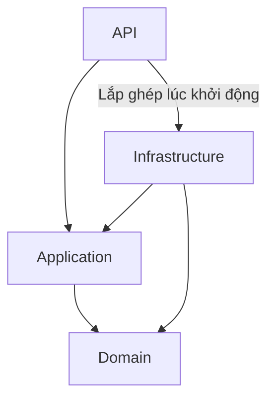
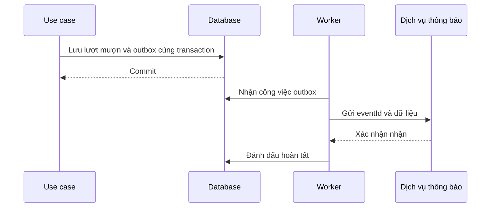

# Clean Architecture: từ nền tảng đến thực chiến

## Bộ 15 bài học bằng tiếng Việt, với ví dụ C#/.NET

Biên soạn cho anh Tim • Ngày 30/10/2026

Đây là bộ bài giảng độc lập, vận dụng các nguyên tắc của Robert C. Martin và các nguồn tham khảo ở cuối tài liệu. Đây không phải bài viết do Robert C. Martin viết, bản dịch sách của ông, hay bản dịch toàn văn các bài tham khảo.

Mục tiêu là giúp người mới hiểu vì sao cần một ranh giới kiến trúc, tự thiết kế được một tính năng, rồi biết kiểm tra những gì trước khi đưa vào vận hành. “Pro” ở đây là khả năng giải thích quyết định và xử lý tình huống khó; đọc xong tài liệu không tự động thay thế trải nghiệm làm dự án.

### Cách đọc

Anh chỉ cần biết sơ bộ biến, hàm, class, interface và HTTP. Nếu chưa biết interface, bài 3 giải thích lại. Đọc mỗi bài theo thứ tự: tình huống → cách giải → ví dụ → bài tập → gợi ý đáp án. Khi gặp một thuật ngữ mới, đọc ý nghĩa tiếng Việt trước khi ghi nhớ tên tiếng Anh.

Ví dụ xuyên suốt là **BookNest**, ứng dụng quản lý mượn sách. Đề bài cố ý nhỏ để anh tập trung vào kiến trúc. Mã C# là các đoạn minh họa có chỉ rõ tầng, không phải một repository hoàn chỉnh đã build. Một số phần như thiết lập xác thực, migrations và giao diện được mô tả nhưng không cung cấp toàn bộ mã. Bộ bài không phụ thuộc một template hay phiên bản NuGet cụ thể. Môi trường biên soạn không có .NET SDK, vì vậy các đoạn mã chưa được biên dịch tại đây.

### Lộ trình

| Bài | Câu hỏi sẽ trả lời | Kết quả thực hành |
|---|---|---|
| 1 | Kiến trúc giải quyết vấn đề gì? | Nhìn ra các lý do thay đổi khác nhau |
| 2 | Bốn tầng chia việc như thế nào? | Đặt đúng trách nhiệm |
| 3 | Dependency, DIP và DI khác nhau ra sao? | Đọc được chiều phụ thuộc |
| 4 | Clean, Hexagonal, Onion và DDD liên quan gì? | Chọn đúng công cụ tư duy |
| 5 | Bắt đầu từ đề bài như thế nào? | Viết use case và quy tắc |
| 6 | Domain có gì ngoài property? | Viết đối tượng bảo vệ trạng thái |
| 7 | Application điều phối công việc ra sao? | Viết luồng mượn sách |
| 8 | Kết nối API và database thế nào? | Nối các thành phần bằng DI |
| 9 | Kiểm thử gì để tin kiến trúc? | Phân biệt unit và integration test |
| 10 | Khi nào cần CQRS? | Tách mô hình đọc và ghi vừa đủ |
| 11 | Hai người cùng mượn một cuốn thì sao? | Hiểu transaction và concurrency |
| 12 | Lưu thành công nhưng gửi thông báo thất bại thì sao? | Hiểu event, outbox và idempotency |
| 13 | Chạy thật cần bổ sung gì? | Quyền truy cập, hiệu năng và quan sát |
| 14 | Nâng cấp hệ thống cũ thế nào? | Refactor từng bước và viết ADR |
| 15 | Làm sao tự đánh giá trình độ? | Hoàn thành đồ án và bảo vệ thiết kế |

---

## Bài 1 — Kiến trúc bắt đầu từ chi phí thay đổi

### Một chức năng nhỏ lớn dần như thế nào?

Ngày đầu, BookNest chỉ cần một API: nhập mã cuốn sách và mã người mượn, sau đó lưu vào database. Một phương thức làm hết mọi việc vẫn có thể chạy đúng.

Một tháng sau, thư viện yêu cầu thêm hạn trả. Tháng tiếp theo, cần gửi email. Sau đó xuất hiện ứng dụng kiosk tại quầy, cũng phải dùng quy tắc mượn sách giống website. Nếu quy tắc đang nằm trong controller, nhóm dễ sao chép nó sang kiosk. Khi chính sách đổi, người sửa phải nhớ sửa cả hai nơi.

Đó là vấn đề kiến trúc: **một thay đổi nghiệp vụ kéo theo quá nhiều nơi phải sửa và kiểm tra**.

Kiến trúc phần mềm là cách phân chia trách nhiệm, xác định ranh giới và quy định các thành phần được biết gì về nhau. Tên folder chỉ là một phần biểu diễn của quyết định đó.

### Phân biệt ba lý do thay đổi

Trong BookNest, có ba yêu cầu hoàn toàn khác nhau:

| Yêu cầu mới | Điều thực sự thay đổi |
|---|---|
| Thời gian mượn từ 14 thành 21 ngày | Chính sách nghiệp vụ |
| JSON dùng tên trường khác | Hợp đồng giao tiếp |
| Lưu dữ liệu bằng một hệ quản trị khác | Cách lưu trữ |

Nếu cả ba cùng sửa vào một class lớn, class đó đang chịu nhiều áp lực thay đổi. Tách chúng giúp việc sửa dễ khoanh vùng hơn. Nhưng tách không có nghĩa là tạo một class cho mỗi dòng code.

### Một ví dụ để nhận ra vấn đề

```csharp
// Ví dụ cố ý gộp nhiều trách nhiệm, không phải mã nên sao chép.
public async Task Borrow(Guid copyId, Guid memberId)
{
    // Đọc dữ liệu bằng SQL.
    // Kiểm tra sách đã được mượn chưa.
    // Tính hạn trả.
    // Ghi dữ liệu.
    // Gửi email qua SMTP.
    // Quyết định HTTP status code.
}
```

Chỉ nhìn tên phương thức chưa thấy sai. Vấn đề hiện rõ khi hỏi: “Muốn kiểm tra quy tắc sách đã được mượn thì có phải dựng database và SMTP không?” Nếu có, việc kiểm thử một quy tắc nhỏ đang bị kéo theo nhiều công cụ.

Clean Architecture hướng tới việc bảo vệ chính sách nghiệp vụ khỏi các chi tiết bên ngoài. Dependency Rule của Robert C. Martin quy định phụ thuộc mã nguồn hướng vào phần bên trong; đó là nguyên tắc cốt lõi được dùng trong loạt bài này. [S1]

### Giá phải trả

Tách lớp tạo thêm interface, mapping và file. Với một công cụ nhập dữ liệu dùng một lần, chi phí ấy có thể không đáng. Với ứng dụng có nhiều quy tắc và nhiều kênh gọi, lợi ích thường rõ hơn. Đừng dùng số lượng project để đo chất lượng.

**Bài tập:** Với tính năng xuất báo cáo, hãy phân biệt quy tắc “ai được xem báo cáo” và chi tiết “ghi file Excel bằng thư viện nào”.

**Gợi ý:** Quyền xem thuộc chính sách truy cập của ứng dụng. Cách tạo file thuộc bộ phận tích hợp kỹ thuật. Đổi thư viện Excel không nên buộc anh viết lại chính sách quyền.

**Điều cần nhớ:** Hãy bắt đầu bằng việc tìm những lý do thay đổi khác nhau.

---

## Bài 2 — Bốn tầng, bốn câu hỏi

### Chia trách nhiệm bằng câu hỏi

Trong bộ bài này, BookNest có bốn project. Đây là lựa chọn để học, không phải quy định mọi ứng dụng phải có đúng bốn project.

| Tầng | Câu hỏi chính | Ví dụ BookNest |
|---|---|---|
| Domain | Điều gì luôn phải đúng trong nghiệp vụ? | Cuốn đang được mượn không được mượn tiếp |
| Application | Cần làm những bước nào cho một yêu cầu? | Xác định người mượn, lấy cuốn sách, gọi thao tác mượn, lưu |
| Infrastructure | Giao tiếp với công nghệ cụ thể thế nào? | EF Core, SQL Server, email |
| API | Nhận và trả thông tin qua HTTP thế nào? | Route, request, response, HTTP status |

Jason Taylor tổ chức phần lõi thành Domain và Application, để các thành phần bên ngoài triển khai interface do lõi cần. Bài NDepend minh họa thêm cách xem phụ thuộc giữa các project. Bộ bài dùng cách tổ chức này làm điểm xuất phát. [S3][S4]

### Một yêu cầu đi qua các tầng

Người dùng bấm “Mượn sách”. API đọc `copyId`, rồi gọi `BorrowBook`. Application lấy người dùng hiện tại từ một interface, đọc cuốn sách qua repository và yêu cầu đối tượng thực hiện `Borrow`. Domain quyết định trạng thái hiện tại có cho phép mượn hay không. Infrastructure lưu thay đổi. API chuyển kết quả thành phản hồi HTTP.

Điều đáng chú ý: Domain không cần biết nút bấm tên gì. Application không cần biết câu SQL viết thế nào. Repository không quyết định người dùng nên nhìn thấy HTTP 409 hay 500.

### Đồ thị phụ thuộc mã nguồn

Mũi tên trong hình có nghĩa **A tham chiếu kiểu dữ liệu hoặc mã của B**.



API tham chiếu Infrastructure ở nơi lắp ghép ứng dụng, thường là `Program.cs`. Controller không vì thế được phép gọi tùy tiện vào `SqlBookRepository`. Quy tắc này cần được giữ bằng review và kiểm tra phụ thuộc.

### Nghiệp vụ ở Domain hay Application?

“Không cho mượn một cuốn đang được mượn” thuộc đối tượng cuốn sách. “Đọc cuốn sách, xác định người gọi rồi lưu thay đổi” thuộc use case. “Thư viện chi nhánh A chỉ cho một nhóm thành viên dùng dịch vụ” có thể cần chính sách truy cập ở Application kết hợp dữ liệu nghiệp vụ.

Không nên phân biệt bằng câu “Domain có logic, Application không có logic”. Application có logic điều phối và chính sách riêng của use case. Điều cần tránh là sao chép cùng quy tắc trạng thái vào nhiều handler.

**Bài tập:** Đặt ba việc sau vào tầng: kiểm tra JSON có parse được GUID, kiểm tra cuốn sách đã cho mượn, chọn tên bảng SQL.

**Gợi ý:** API, Domain, Infrastructure. Nếu GUID rỗng về mặt nghiệp vụ, lõi vẫn phải từ chối dù JSON hợp lệ.

**Điều cần nhớ:** Chia theo trách nhiệm, không chia theo số dòng.

---

## Bài 3 — Dependency, DIP và DI: ba ý khác nhau

### Dependency là “tôi cần biết anh để làm việc”

Nếu `BorrowBook` gọi trực tiếp `SqlBookRepository`, mã của use case phải biết class SQL đó. Hai thành phần có một phụ thuộc mã nguồn.

```csharp
// Cách làm khiến use case biết chi tiết SQL.
var repository = new SqlBookRepository(connectionString);
```

Muốn thay repository bằng một bản giả trong test, anh phải tìm cách can thiệp vào chỗ tạo object. Muốn dùng nguồn dữ liệu khác, anh sửa use case dù quy trình mượn sách chưa đổi.

### Interface là một hợp đồng

Giả sử Application chỉ cần “lấy một cuốn sách theo mã”. Nó có thể mô tả nhu cầu đó:

```csharp
public interface IBookCopyRepository
{
    Task<BookCopy?> GetAsync(Guid id, CancellationToken ct);
}
```

Interface không thực hiện câu SQL. Nó nói bên cung cấp dịch vụ phải có thao tác nào, nhận gì và trả gì. Infrastructure viết `EfBookCopyRepository` để thực hiện hợp đồng.

Điểm quyết định là **hợp đồng nằm ở bên cần nó**, không nằm ở project SQL rồi buộc Application tham chiếu ngược ra ngoài. Đây là cách áp dụng Dependency Inversion Principle, thường viết tắt DIP, vào ví dụ.

### DI là cách đưa object vào

```csharp
public sealed class BorrowBook
{
    private readonly IBookCopyRepository _copies;

    public BorrowBook(IBookCopyRepository copies)
    {
        _copies = copies;
    }
}
```

`BorrowBook` nhận repository từ bên ngoài thay vì tự tạo. Đó là constructor injection, một cách làm Dependency Injection, viết tắt DI.

Anh có thể tự `new BorrowBook(fakeRepository)` trong test mà không dùng DI container. Container chỉ giúp lắp ghép nhiều object tự động. Dùng `AddScoped` không tự đảm bảo kiến trúc đúng: nếu constructor nhận thẳng `SqlBookRepository`, use case vẫn biết chi tiết SQL.

### Luồng chạy khác chiều phụ thuộc

Lúc chạy, use case thực sự gọi repository SQL để lấy dữ liệu. Nhưng lúc biên dịch, use case chỉ biết interface của Application. Class SQL mới là bên phải tuân theo interface ấy.

Đây là lý do hình vẽ “tất cả mũi tên hướng vào trong” không có nghĩa chương trình không được gọi database. Nó mô tả sự phụ thuộc của mã nguồn, không mô tả mọi lời gọi lúc chạy. [S1]

### Có cần interface cho mọi class?

Không. `BorrowBook` có thể là class cụ thể. Tách interface khi cần một ranh giới có ý nghĩa: database, đồng hồ, người dùng hiện tại hoặc dịch vụ ngoài. Một cặp `IStringHelper` và `StringHelper` chỉ gọi `Trim()` chưa chắc tạo lợi ích.

**Bài tập:** Một interface nằm trong Infrastructure, Application tham chiếu Infrastructure để sử dụng nó. Đã đảo chiều phụ thuộc chưa?

**Gợi ý:** Chưa theo thiết kế của bộ bài. Interface tồn tại, nhưng chiều project reference vẫn hướng ra ngoài. Chuyển hợp đồng cần thiết vào lõi và để adapter triển khai nó.

**Điều cần nhớ:** DIP nói về hướng thiết kế; DI nói về cách cung cấp dependency.

---

## Bài 4 — Clean, Hexagonal, Onion, DDD và CQRS không phải cùng một thứ

### Vì sao người mới dễ rối?

Một template có thể đồng thời ghi “Clean Architecture, DDD, CQRS, MediatR”. Người học dễ tưởng đó là một bộ bắt buộc. Thực tế, các khái niệm giải quyết những câu hỏi khác nhau.

| Khái niệm | Cách hiểu ban đầu | Câu hỏi áp dụng vào BookNest |
|---|---|---|
| Clean Architecture | Tách chính sách và chi tiết, kiểm soát chiều phụ thuộc | Mã mượn sách có bị buộc vào HTTP và SQL không? |
| Hexagonal / Ports and Adapters | Lõi giao tiếp qua các cổng và bộ chuyển đổi | Website và kiosk có gọi cùng một khả năng không? |
| Onion | Đặt mô hình nghiệp vụ ở trung tâm và tổ chức phụ thuộc bao quanh | Phần lưu trữ có phụ thuộc mô hình lõi không? |
| DDD | Mô hình hóa nghiệp vụ bằng ngôn ngữ và ranh giới rõ ràng | “Đầu sách” và “bản sách” có phải cùng đối tượng không? |
| CQRS | Tách trách nhiệm và mô hình đọc với ghi | Danh sách sách có cần dùng toàn bộ mô hình mượn không? |
| Microservices | Chia hệ thống thành dịch vụ có thể triển khai độc lập | Có thật sự cần tách vận hành từng phần không? |

Herberto Graça trình bày cách kết hợp nhiều ý tưởng này. Điểm hữu ích cho người học là nhìn lõi, cổng giao tiếp và adapter như những vai trò rõ ràng. Cổng cần phản ánh nhu cầu của lõi, thay vì chỉ sao chép API của công cụ bên ngoài. [S2]

### Một cổng, hai cách triển khai

BookNest cần biết thời gian hiện tại. Cổng là `IClock`. Khi chạy thật, adapter đọc đồng hồ hệ thống. Khi kiểm thử, adapter trả một thời điểm cố định. Use case không cần biết đang dùng cách nào.

Tương tự, HTTP controller là bên đưa yêu cầu vào use case. Repository SQL là bên thực hiện yêu cầu lấy dữ liệu từ use case. Hai bên đều ở ranh giới nhưng đóng vai trò khác nhau.

### DDD giúp phát hiện nhầm lẫn sớm

Cuốn “Clean Code” là một đầu sách. Thư viện có ba bản vật lý của đầu sách đó, mỗi bản có mã vạch riêng. Quy tắc “không cho mượn hai lần” phải áp dụng trên từng bản vật lý, không phải trên tên đầu sách.

Vì thế ví dụ chọn tên `BookCopy`, không chọn `Book` chung chung. Đây là một quyết định mô hình hóa có giá trị hơn việc thêm nhiều project trước khi hiểu nghiệp vụ.

### Điểm khởi đầu của bộ bài

Ta dùng một ứng dụng triển khai chung, một database, bốn project và gọi use case trực tiếp. Chưa cần message broker, event sourcing hay microservices. Đến khi một vấn đề cụ thể xuất hiện, ta mới thêm cơ chế phù hợp.

**Bài tập:** Nếu tách `BorrowCommand` và `BookListQuery`, anh đã có microservices chưa?

**Gợi ý:** Chưa. Tách mã đọc/ghi là quyết định trong ứng dụng. Microservices còn liên quan ranh giới dịch vụ, triển khai, giao tiếp và vận hành độc lập.

**Điều cần nhớ:** Các mẫu có thể kết hợp, nhưng không phải một gói phải dùng đủ.

---

## Bài 5 — Thiết kế từ use case, trước khi tạo folder

### Viết một câu chuyện đủ cụ thể

“Quản lý sách” quá rộng để thiết kế. “Thành viên đang đăng nhập mượn một bản sách còn sẵn” cụ thể hơn nhiều. Câu thứ hai cho biết người thực hiện, hành động và điều kiện.

Đề bài đầu tiên của BookNest được chốt như sau:

| Nội dung | Quyết định cho bài học |
|---|---|
| Người gọi | Thành viên đã đăng nhập |
| Đầu vào | Mã bản sách |
| Nhận diện người mượn | Lấy từ danh tính đã được hệ thống xác minh |
| Điều kiện | Bản sách tồn tại và chưa được mượn |
| Kết quả | Ghi người mượn và hạn trả |
| Hạn trả | Sau đúng 14 × 24 giờ, dùng thời điểm UTC |
| Ngoài phạm vi ban đầu | Tiền phạt, lịch sử mượn, đặt trước, giới hạn số sách |

Định nghĩa 14 × 24 giờ là cố ý. “Đúng 17 giờ ngày thứ 14 theo giờ địa phương” là một chính sách khác, phải thiết kế ngày giờ và lịch tương ứng. Đừng để một lời nói mơ hồ biến thành bug.

### Viết ví dụ trước mã nguồn

**Trường hợp thành công:** Bản C01 đang trống. Thành viên M01 mượn vào 01/11/2026 lúc 08:00 UTC. Hạn trả là 15/11/2026 lúc 08:00 UTC.

**Trường hợp bị từ chối:** C01 đang thuộc lượt mượn của M02. M01 thử mượn. Hệ thống không thay người mượn và không thay hạn trả.

**Trường hợp không tìm thấy:** Mã C99 không tồn tại. Không tạo mới bản sách để “cho chạy tiếp”.

**Trường hợp chưa đăng nhập:** Không nhận mã thành viên tùy ý từ request để thay thế danh tính.

Các ví dụ này sẽ trở thành kiểm thử. Nếu chưa thống nhất được kết quả mong đợi, viết thêm interface chưa giải quyết được vấn đề.

### Từ câu chuyện thành trách nhiệm

Ta cần `BookCopy` giữ trạng thái và quy tắc. Ta cần `BorrowBook` thực hiện quy trình. Ta cần `IBookCopyRepository` để tìm bản sách, `IUnitOfWork` để lưu, `ICurrentMember` để lấy danh tính, `IClock` để lấy thời gian.

Đây là các dependency được suy ra từ nhu cầu. Không bắt đầu bằng một danh sách pattern rồi tìm cách nhét chúng vào bài toán.

### Một giới hạn quan trọng

Bản đầu chỉ giữ lượt mượn hiện tại. Khi trả sách, thông tin hiện tại được xóa. Nếu cần lịch sử, phải bổ sung mô hình `Loan` hoặc nhật ký nghiệp vụ phù hợp. Không được gọi bản đầu là hệ thống thư viện đầy đủ.

**Bài tập:** Viết ba ví dụ cho tính năng trả sách: trả thành công, trả cuốn chưa mượn, người không có quyền trả.

**Gợi ý:** Quy tắc trạng thái và quyền người gọi là hai kiểm tra riêng. Một cuốn đang được mượn không có nghĩa mọi người đều có quyền trả thay.

**Điều cần nhớ:** Một use case rõ ràng là đầu vào tốt nhất cho kiến trúc.

---

## Bài 6 — Domain: bảo vệ quy tắc ngay trong đối tượng

### Property không đủ diễn tả hành vi

Nếu `BorrowerId` và `DueAt` đều có public setter, mọi đoạn code có thể gán người mượn mà quên hạn trả. Ta muốn đối tượng không bị chuyển sang trạng thái vô nghĩa qua API công khai của nó.

Mã dưới đây đặt trong project Domain; để ngắn gọn, các snippet không lặp namespace và những `using` cơ bản.

```csharp
public sealed class DomainRuleException : Exception
{
    public string Code { get; }

    public DomainRuleException(string code, string message) : base(message)
    {
        Code = code;
    }
}

public sealed class BookCopy
{
    public Guid Id { get; private set; }
    public Guid? BorrowerId { get; private set; }
    public DateTimeOffset? DueAt { get; private set; }

    private BookCopy() { }

    public BookCopy(Guid id)
    {
        if (id == Guid.Empty)
            throw new ArgumentException("Mã bản sách không được rỗng.", nameof(id));

        Id = id;
    }

    public void Borrow(Guid memberId, DateTimeOffset now)
    {
        if (memberId == Guid.Empty)
            throw new DomainRuleException("InvalidMember", "Thiếu mã thành viên.");

        if (BorrowerId.HasValue)
            throw new DomainRuleException("AlreadyBorrowed", "Bản sách đã được mượn.");

        BorrowerId = memberId;
        DueAt = now.ToUniversalTime().AddDays(14);
    }

    public void Return()
    {
        if (!BorrowerId.HasValue)
            throw new DomainRuleException("NotBorrowed", "Bản sách chưa được mượn.");

        BorrowerId = null;
        DueAt = null;
    }
}
```

`Borrow` làm rõ ý định hơn `UpdateStatus`. Người đọc biết hành động đang xảy ra, không phải đoán từ một loạt phép gán. Không có HTTP, SQL hoặc EF Core trong class này.

### Invariant là gì?

Invariant là điều phải được giữ đúng qua các thao tác hợp lệ. Trong ví dụ, không có người mượn thì không có hạn trả; có người mượn thì phải có hạn trả. `Borrow` và `Return` cập nhật hai giá trị cùng nhau.

Private setter giúp bảo vệ API của đối tượng, nhưng không ngăn mọi thay đổi trực tiếp trong database. Khi triển khai, ta còn cần ràng buộc dữ liệu phù hợp và kiểm thử mapping. Domain không thay thế toàn bộ cơ chế bảo vệ của database.

### Entity và value object

`BookCopy` là entity vì danh tính của nó là mã riêng. Hai bản sách cùng tên vẫn là hai đối tượng khác nhau. Không dùng `GetHashCode()` làm mã định danh nghiệp vụ: hash không bảo đảm duy nhất và không thay thế ID ổn định.

Một value object được so sánh theo giá trị, chẳng hạn khoảng thời gian có ngày bắt đầu và kết thúc. Nếu thêm `LoanPeriod`, nó có thể tự kiểm tra ngày kết thúc phải sau ngày bắt đầu. Không cần tạo value object cho mọi string chỉ để làm mô hình trông phức tạp.

### Aggregate hiểu đơn giản

Aggregate là nhóm đối tượng được quản lý như một ranh giới nhất quán; aggregate root là cửa vào để thay đổi nhóm đó. Bản đầu coi một `BookCopy` là aggregate đơn giản. Sau này nếu thêm lịch sử, không nên mặc định nhét hàng triệu lượt mượn vào collection phải tải mỗi lần mở cuốn sách.

**Bài tập:** Vì sao `Return()` không nhận `HttpContext` để kiểm tra người gọi?

**Gợi ý:** HTTP là chi tiết giao tiếp. Application kiểm tra quyền dựa trên danh tính và tài nguyên, sau đó yêu cầu đối tượng thực hiện chuyển trạng thái hợp lệ.

**Điều cần nhớ:** Domain diễn tả hành vi và giữ quy tắc, không chỉ chứa các property của bảng.

---

## Bài 7 — Application: người điều phối một use case

### Hợp đồng mà use case cần

Đặt những interface sau trong Application. Project này tham chiếu Domain để biết `BookCopy`.

```csharp
public interface IBookCopyRepository
{
    Task<BookCopy?> GetAsync(Guid id, CancellationToken ct);
}

public interface IUnitOfWork
{
    Task SaveChangesAsync(CancellationToken ct);
}

public interface ICurrentMember
{
    Guid? MemberId { get; }
}

public interface IClock
{
    DateTimeOffset UtcNow { get; }
}

public sealed record BorrowReceipt(Guid CopyId, DateTimeOffset DueAt);

public enum BorrowError
{
    None, InvalidCopyId, Unauthenticated, NotFound, AlreadyBorrowed
}

public sealed record BorrowResult(BorrowReceipt? Receipt, BorrowError Error);
```

`BorrowReceipt` là DTO, đối tượng chuyển dữ liệu. Nó chỉ trả những gì người gọi cần. Không trả nguyên entity để client vô tình phụ thuộc toàn bộ mô hình bên trong.

Trong ví dụ, repository trả entity được theo dõi thay đổi trong cùng một đơn vị công việc; `SaveChangesAsync` sẽ lưu thay đổi của entity ấy. Đây là hợp đồng hành vi cần được ghi lại và kiểm thử, vì chữ ký interface chưa diễn tả hết điều đó.

### Luồng mượn sách

```csharp
public sealed class BorrowBook
{
    private readonly IBookCopyRepository _copies;
    private readonly IUnitOfWork _unitOfWork;
    private readonly ICurrentMember _currentMember;
    private readonly IClock _clock;

    public BorrowBook(
        IBookCopyRepository copies,
        IUnitOfWork unitOfWork,
        ICurrentMember currentMember,
        IClock clock)
    {
        _copies = copies;
        _unitOfWork = unitOfWork;
        _currentMember = currentMember;
        _clock = clock;
    }

    public async Task<BorrowResult> ExecuteAsync(Guid copyId, CancellationToken ct)
    {
        var memberId = _currentMember.MemberId;
        if (memberId is null || memberId == Guid.Empty)
            return new(null, BorrowError.Unauthenticated);

        if (copyId == Guid.Empty)
            return new(null, BorrowError.InvalidCopyId);

        var copy = await _copies.GetAsync(copyId, ct);
        if (copy is null)
            return new(null, BorrowError.NotFound);

        try
        {
            copy.Borrow(memberId.Value, _clock.UtcNow);
        }
        catch (DomainRuleException ex) when (ex.Code == "AlreadyBorrowed")
        {
            return new(null, BorrowError.AlreadyBorrowed);
        }

        await _unitOfWork.SaveChangesAsync(ct);
        return new(new BorrowReceipt(copy.Id, copy.DueAt!.Value), BorrowError.None);
    }
}
```

Đọc theo động từ: xác định người gọi → tìm sách → mượn → lưu → trả biên nhận. Nếu đổi HTTP sang một màn hình kiosk, chuỗi thao tác nghiệp vụ vẫn dùng lại được; adapter danh tính cũng phải được cung cấp đúng.

### Vì sao không bắt tất cả exception?

`AlreadyBorrowed` là một kết quả nghiệp vụ dự kiến. Database mất kết nối là một sự cố khác. Nếu biến mọi exception thành “sách đã được mượn”, người dùng nhận thông tin sai và người vận hành mất dấu lỗi thật.

Tại đây, lỗi lưu dữ liệu chưa được chuyển thành kết quả nghiệp vụ. API cần xử lý lỗi bất ngờ tập trung. Bài 11 sẽ thêm trường hợp xung đột đồng thời, vì `Borrow` đúng trong bộ nhớ chưa đủ bảo vệ hai request chạy cùng lúc.

### Tại sao dùng IClock?

Nếu use case đọc thời gian hệ thống trực tiếp, test phải chạy theo đồng hồ thật. Với `IClock`, test chọn đúng một thời điểm rồi tính được hạn trả chính xác. Đây là abstraction nhỏ nhưng có mục đích rõ ràng.

**Bài tập:** Thêm use case trả sách. Trước khi gọi `Return`, phải kiểm tra điều gì ngoài việc tìm thấy sách?

**Gợi ý:** Người gọi có quyền trả bản sách đó không, ví dụ chính người mượn hoặc nhân viên được cấp quyền. Không tin `memberId` gửi tùy ý trong body.

**Điều cần nhớ:** Application kể lại quy trình; Domain quyết định thao tác nghiệp vụ có hợp lệ hay không.

---

## Bài 8 — Nối database và API mà không kéo chi tiết vào lõi

### Adapter lưu trữ

Các đoạn sau nằm trong Infrastructure và cần package EF Core/provider phù hợp phiên bản .NET của dự án. Những class như `DbContext` và `ModelBuilder` thuộc namespace `Microsoft.EntityFrameworkCore`.

```csharp
public sealed class LibraryDbContext : DbContext, IUnitOfWork
{
    public LibraryDbContext(DbContextOptions<LibraryDbContext> options)
        : base(options) { }

    public DbSet<BookCopy> BookCopies => Set<BookCopy>();

    protected override void OnModelCreating(ModelBuilder modelBuilder)
    {
        var copy = modelBuilder.Entity<BookCopy>();
        copy.ToTable("BookCopies");
        copy.HasKey(x => x.Id);
        copy.Property(x => x.BorrowerId);
        copy.Property(x => x.DueAt);
    }

    async Task IUnitOfWork.SaveChangesAsync(CancellationToken ct)
    {
        await base.SaveChangesAsync(ct);
    }
}

public sealed class EfBookCopyRepository : IBookCopyRepository
{
    private readonly LibraryDbContext _db;

    public EfBookCopyRepository(LibraryDbContext db) => _db = db;

    public Task<BookCopy?> GetAsync(Guid id, CancellationToken ct) =>
        _db.BookCopies.SingleOrDefaultAsync(x => x.Id == id, ct);
}

public sealed class SystemClock : IClock
{
    public DateTimeOffset UtcNow => DateTimeOffset.UtcNow;
}
```

Repository này dùng tracking vì sẽ sửa entity rồi lưu. Không thêm `AsNoTracking()` ở đây một cách máy móc; nếu dùng dữ liệu không tracking thì phải thiết kế rõ cách attach/update và concurrency token.

### Lắp ghép trong Program.cs

Đây là đoạn đăng ký dịch vụ minh họa, không phải toàn bộ `Program.cs`:

```csharp
builder.Services.AddDbContext<LibraryDbContext>(options =>
    options.UseSqlServer(builder.Configuration.GetConnectionString("Library")));

builder.Services.AddScoped<IBookCopyRepository, EfBookCopyRepository>();
builder.Services.AddScoped<IUnitOfWork>(sp =>
    sp.GetRequiredService<LibraryDbContext>());
builder.Services.AddSingleton<IClock, SystemClock>();
builder.Services.AddScoped<BorrowBook>();
```

Điểm quan trọng là repository và unit of work dùng **cùng instance DbContext trong request**. Nếu đăng ký sai để mỗi bên giữ một context riêng, `SaveChangesAsync` có thể không lưu entity vừa sửa.

`ICurrentMember` cần một adapter ở API để đọc danh tính đã xác thực và ánh xạ sang mã thành viên nội bộ. Không giả định mọi claim `sub` đều là GUID của thành viên. Khi dùng nhà cung cấp danh tính ngoài, thường phải có bước ánh xạ. Cấu hình xác thực và adapter này là phần người triển khai phải bổ sung.

### API chuyển kết quả thành HTTP

Sau khi đã cấu hình authentication, authorization và adapter danh tính, có thể ánh xạ endpoint như sau:

```csharp
app.MapPost("/copies/{copyId:guid}/borrow", async (
    Guid copyId, BorrowBook useCase, CancellationToken ct) =>
{
    var result = await useCase.ExecuteAsync(copyId, ct);

    IResult response = result.Error switch
    {
        BorrowError.None => Results.Ok(result.Receipt),
        BorrowError.InvalidCopyId => Results.BadRequest(new { code = "InvalidCopyId" }),
        BorrowError.Unauthenticated => Results.Unauthorized(),
        BorrowError.NotFound => Results.NotFound(),
        BorrowError.AlreadyBorrowed => Results.Conflict(new { code = "AlreadyBorrowed" }),
        _ => Results.Problem("Không thể xử lý yêu cầu.")
    };
    return response;
}).RequireAuthorization();
```

Use case không trả `IResult`, controller không trả nguyên exception SQL. Mỗi phía giữ ngôn ngữ của mình.

### “Đổi database dễ” cần hiểu thực tế

Ranh giới giúp giảm chỗ phải sửa trong nghiệp vụ. Nó không làm mất công chuyển schema, dữ liệu, index, transaction, kiểu dữ liệu và truy vấn. Thay SQL Server bằng MongoDB có thể buộc thay đổi cách bảo đảm nhất quán. Đừng hứa đổi database chỉ bằng một dòng DI.

**Bài tập:** Vì sao không đăng ký `LibraryDbContext` thành singleton dùng chung toàn ứng dụng?

**Gợi ý:** Nó giữ trạng thái theo dõi entity và không dành cho việc sử dụng đồng thời tùy ý giữa nhiều request. Vòng đời phải phù hợp đơn vị công việc.

**Điều cần nhớ:** Nơi lắp ghép được biết các implementation; use case không cần biết chúng.

---

## Bài 9 — Kiểm thử theo loại rủi ro

### Đừng chỉ hỏi “coverage bao nhiêu phần trăm?”

Một dự án có nhiều test vẫn có thể cho hai người mượn cùng cuốn sách. Câu hỏi hữu ích hơn là: “Nếu điều quan trọng này bị sai, test nào phát hiện?”

Với BookNest, cần phân biệt các tầng kiểm thử:

| Loại | Điều cần chứng minh | Phụ thuộc thật |
|---|---|---|
| Domain unit test | Quy tắc trạng thái và hạn trả | Không có database |
| Application unit test | Điều phối, phân nhánh và kết quả | Fake các cổng |
| Integration test | Mapping, lưu dữ liệu, transaction, concurrency | Database test tương ứng môi trường thật |
| API test | Route, quyền và mã phản hồi | Host ứng dụng test |
| Architecture check | Không có tham chiếu sai chiều | Đọc assembly/project reference |

### Hai test nhỏ nhưng có ý nghĩa

Đoạn minh họa dùng cú pháp xUnit:

```csharp
[Fact]
public void Borrow_SetsDueDateToFourteenDaysLater()
{
    var copy = new BookCopy(Guid.NewGuid());
    var memberId = Guid.NewGuid();
    var now = new DateTimeOffset(2026, 11, 1, 8, 0, 0, TimeSpan.Zero);

    copy.Borrow(memberId, now);

    Assert.Equal(memberId, copy.BorrowerId);
    Assert.Equal(now.AddDays(14), copy.DueAt);
}

[Fact]
public void Borrow_WhenAlreadyBorrowed_PreservesOriginalBorrower()
{
    var copy = new BookCopy(Guid.NewGuid());
    var firstMember = Guid.NewGuid();
    var now = new DateTimeOffset(2026, 11, 1, 8, 0, 0, TimeSpan.Zero);
    copy.Borrow(firstMember, now);

    var error = Assert.Throws<DomainRuleException>(() =>
        copy.Borrow(Guid.NewGuid(), now.AddDays(1)));

    Assert.Equal("AlreadyBorrowed", error.Code);
    Assert.Equal(firstMember, copy.BorrowerId);
    Assert.Equal(now.AddDays(14), copy.DueAt);
}
```

Test thứ hai không chỉ kiểm tra có exception. Nó còn kiểm tra yêu cầu bị từ chối không làm hỏng người mượn và hạn trả ban đầu.

### Test use case bằng fake

Tạo `FakeClock` trả thời điểm cố định, `FakeCurrentMember` trả người dùng xác định và repository trả một cuốn sách đã chuẩn bị. Đối với trường hợp không tìm thấy sách, xác nhận kết quả là `NotFound` và không lưu thay đổi. Đối với chưa đăng nhập, không nên đọc sách hay lưu dữ liệu.

Không cần mock từng property getter. Hãy tập trung vào kết quả và các tác động quan trọng. Test quá bám sát thứ tự lời gọi nội bộ có thể vỡ khi refactor dù hành vi không đổi.

### Fake không chứng minh SQL đúng

Một dictionary giả lập không kiểm tra được unique constraint, collation hay `rowversion` của SQL Server. Những hành vi phụ thuộc database phải được thử với database tương ứng. Dữ liệu test cần riêng biệt và có cơ chế dọn dẹp rõ ràng.

### Bảo vệ kiến trúc

Trong CI, có thể kiểm tra Domain không tham chiếu Application/Infrastructure/API, Application không tham chiếu Infrastructure/API. Đồng thời review việc đưa SQL, HTTP và kiểu ORM vào hợp đồng lõi. Chỉ kiểm tra project reference chưa bắt được mọi rò rỉ thiết kế.

**Bài tập:** Test “mượn lần hai trên cùng object” có chứng minh hai HTTP request đồng thời được xử lý đúng không?

**Gợi ý:** Không. Hai request có thể đọc hai object riêng từ cùng dữ liệu cũ. Cần bài kiểm thử với hai đơn vị công việc riêng; bài 11 giải quyết tình huống này.

**Điều cần nhớ:** Test phải đối diện rủi ro thật, không chỉ chạy lại cấu trúc code.

---

## Bài 10 — CQRS: tách đọc và ghi khi chúng có nhu cầu khác nhau

### Màn hình danh sách không cần mượn sách

Để thực hiện mượn, ta cần kiểm tra trạng thái và thay đổi một `BookCopy`. Nhưng để hiện danh sách, giao diện chỉ cần mã sách, tiêu đề và tình trạng còn sẵn. Nạp toàn bộ mô hình ghi rồi chuyển nó sang màn hình có thể gây công việc thừa.

CQRS tách trách nhiệm và mô hình phục vụ đọc với ghi. Có thể bắt đầu với cùng một database, không cần hai hệ lưu trữ. Microsoft mô tả đây là một mức triển khai cơ bản của CQRS. [S5]

### Thiết kế nhỏ cho BookNest

```csharp
// Application: hợp đồng dành riêng cho dữ liệu màn hình.
public sealed record CopyListItem(Guid Id, bool IsAvailable);

public interface IBookCopyQueries
{
    Task<IReadOnlyList<CopyListItem>> ListAsync(
        int page, int pageSize, CancellationToken ct);
}
```

Implementation trong Infrastructure có thể dùng EF projection, SQL hoặc Dapper. Trước khi gọi, Application kiểm tra `page >= 1`, giới hạn `pageSize` trong khoảng cho phép và tránh phép nhân offset bị tràn. Ví dụ truy vấn cho dữ liệu nhỏ:

```csharp
// Phần thân minh họa, sau khi đã kiểm tra page và pageSize.
return await _db.BookCopies
    .AsNoTracking()
    .OrderBy(x => x.Id)
    .Skip((page - 1) * pageSize)
    .Take(pageSize)
    .Select(x => new CopyListItem(x.Id, x.BorrowerId == null))
    .ToListAsync(ct);
```

Query trả DTO, không mang hành vi `Borrow`. Command đi qua quy tắc ghi. Đây là sự tách biệt hữu ích ngay cả khi cả hai vẫn truy cập cùng bảng.

### MediatR có bắt buộc không?

Không. Trong bộ bài, API gọi `BorrowBook.ExecuteAsync` trực tiếp. Mediator có thể hữu ích để chuẩn hóa việc dispatch và pipeline khi dự án có nhiều handler, nhưng bản thân thư viện không tạo ra ranh giới nghiệp vụ tốt.

CQRS cũng không bắt buộc event sourcing. Event sourcing lưu lịch sử sự kiện làm nguồn khôi phục trạng thái; đó là một quyết định khác, có chi phí riêng về replay, tiến hóa schema và vận hành.

### Khi nào chưa cần CQRS phức tạp?

Một bảng danh mục nhỏ với vài màn hình CRUD có thể chỉ cần service rõ ràng và truy vấn tốt. Nếu tạo hai database rồi xây đồng bộ chỉ để hiển thị vài chục dòng, chi phí vận hành có thể lớn hơn lợi ích.

Khi tách kho đọc riêng, phải trả lời: dữ liệu được phép trễ bao lâu? Sau khi mượn, giao diện có thể vẫn thấy “còn sẵn” trong chốc lát không? Nếu không được phép, phải chọn cách đọc và đồng bộ đáp ứng yêu cầu ấy.

**Bài tập:** Vì sao query “xem danh sách” không nên tự sửa sách quá hạn thành “đã mất”?

**Gợi ý:** Đọc màn hình sẽ tạo tác động nghiệp vụ bất ngờ. Việc xác nhận mất sách nên là một hành động rõ ràng, có quyền và kiểm thử riêng.

**Điều cần nhớ:** Tách để phục vụ nhu cầu khác nhau, không phải để tăng số handler.

---

## Bài 11 — Transaction và concurrency: đúng trong một request chưa đủ

### Tình huống hai người cùng bấm mượn

Request A đọc C01 và thấy chưa có người mượn. Request B cũng đọc C01 trước khi A lưu. Hai object trong bộ nhớ đều hợp lệ để gọi `Borrow`. Nếu chỉ cập nhật theo ID, request lưu sau có thể ghi đè người mượn của request trước.

Domain không sai khi kiểm tra trạng thái nó đang có. Vấn đề là trạng thái đó đã cũ vào lúc ghi.

### Transaction giải quyết điều gì?

Transaction giúp một nhóm thao tác dữ liệu cùng thành công hoặc cùng bị hủy. Với provider hỗ trợ, các thay đổi của một lần `SaveChanges` được EF Core áp dụng nguyên tử theo hành vi mặc định. Nhiều lần `SaveChanges` không tự tạo thành một transaction chung. [S6]

Nhưng transaction không có nghĩa mọi luồng được tự động chạy tuần tự. Với cách đọc trước, ghi sau thông thường, vẫn phải thiết kế mức cô lập, khóa hoặc kiểm tra phiên bản để bảo vệ quy tắc.

### Optimistic concurrency bằng rowversion

Với SQL Server, ta có thể thêm concurrency token ở mapping Infrastructure:

```csharp
// Thêm trong OnModelCreating; cần migration cập nhật database.
copy.Property<byte[]>("Version").IsRowVersion();
```

Đây là shadow property do EF quản lý, không cần thêm kiểu SQL vào Domain. EF dùng phiên bản đã đọc khi cập nhật; nếu bản ghi đã đổi, thao tác không khớp và phát sinh `DbUpdateConcurrencyException`. `rowversion` là đặc tính SQL Server, không phải giải pháp chung cho mọi provider. [S7]

### Chuyển lỗi ở đúng ranh giới

Application có thể định nghĩa exception hoặc kiểu kết quả `WriteConflict`. Infrastructure bắt `DbUpdateConcurrencyException` và chuyển sang lỗi ấy. Use case/API trả thông báo phù hợp, chẳng hạn HTTP 409: dữ liệu đã đổi, vui lòng tải lại.

Không để Application phải `catch` exception EF nếu mục tiêu đã chọn là không phụ thuộc EF. Cũng không retry bằng cách lưu lại object cũ. Muốn thử lại, cần đọc trạng thái mới và đánh giá lại toàn bộ quy tắc; có thể kết quả đúng lúc này là “sách đã được người khác mượn”.

### Quy tắc trên nhiều bản ghi khó hơn

Giả sử thêm điều kiện “mỗi thành viên chỉ được mượn tối đa ba cuốn”. Thành viên hiện có hai cuốn, rồi đồng thời mượn C01 và C02. Hai request sửa hai bản sách khác nhau, nên token trên từng cuốn không nhất thiết xung đột. Cả hai có thể cùng vượt qua bước đếm.

Cần một điểm phối hợp theo thành viên: chẳng hạn cập nhật có điều kiện trên bản ghi hạn mức, hoặc khóa/mức cô lập phù hợp trong transaction. Phải phân tích deadlock và tải thực tế. Đặt mọi thứ vào `BookCopy.Borrow()` không tự giải quyết được quy tắc nhiều aggregate.

### Test bắt buộc cho tình huống này

Tạo hai context riêng. Cả hai đọc cùng cuốn trước khi bên nào lưu. Cho A lưu trước, rồi B lưu. Kỳ vọng chỉ một yêu cầu thành công, người mượn của A không bị ghi đè. Không dùng test chạy tuần tự hoàn toàn để giả làm test concurrency.

**Bài tập:** `lock` trong một process có bảo vệ được khi ứng dụng chạy hai replica không?

**Gợi ý:** Không. Hai process có khóa bộ nhớ riêng. Cơ chế bảo vệ phải bao phủ các nơi có thể ghi cùng dữ liệu.

**Điều cần nhớ:** Transaction bảo vệ nhóm thay đổi; concurrency bảo vệ trước thay đổi cạnh tranh. Hai vấn đề liên quan nhưng khác nhau.

---

## Bài 12 — Event, outbox và idempotency: xử lý một nửa thành công

### Database đã lưu, email lại lỗi

Giả sử sau khi mượn, BookNest gửi email hạn trả. Nếu gửi email trước rồi lưu database thất bại, người dùng nhận thông báo cho một lượt mượn chưa tồn tại. Nếu lưu trước rồi gửi email, process có thể dừng giữa hai bước khiến không có thông báo.

Chuyển email sang `Task.Run` không tạo độ bền. Process bị dừng vẫn có thể làm mất công việc đang nằm trong bộ nhớ.

### Phân biệt ba loại thông tin

| Loại | Ý nghĩa | Ví dụ |
|---|---|---|
| Command | Yêu cầu thực hiện việc gì | BorrowBook |
| Domain event | Sự việc nghiệp vụ đã xảy ra trong mô hình | BookBorrowed |
| Integration event | Hợp đồng thông báo cho phần khác | BookBorrowedV1 |

Một domain event không mặc nhiên là message bền vững. Nếu nó chỉ nằm trong collection của entity, database commit xong rồi process dừng trước khi publish thì sự kiện vẫn có thể mất.

### Outbox trong BookNest

Trong cùng transaction, lưu trạng thái mượn và một bản ghi outbox mô tả thông báo cần phát. Worker riêng đọc outbox, gửi message, rồi đánh dấu đã xử lý. AWS mô tả outbox như cách giải quyết rủi ro ghi dữ liệu và phát thông báo thành hai thao tác tách rời. [S8]



Outbox row có thể gồm ID sự kiện, loại, phiên bản payload, thời điểm tạo, dữ liệu, số lần thử và trạng thái. Worker cần cơ chế claim/lease nếu có nhiều instance, tránh các worker cùng xử lý vô kiểm soát.

### Vì sao vẫn có message trùng?

Worker gửi thành công nhưng dừng trước khi đánh dấu hoàn tất. Lần sau nó gửi lại. Vì vậy bên nhận phải chịu được xử lý lặp. Đây là ý nghĩa thực dụng của idempotency: cùng một yêu cầu được xử lý lại không tạo thêm tác động nghiệp vụ không mong muốn.

Với consumer ghi database, có thể lưu `eventId` đã xử lý cùng transaction với tác động nghiệp vụ và unique constraint. Với email hoặc dịch vụ ngoài, local database không thể tự giao dịch nguyên tử với nhà cung cấp; cần xem nhà cung cấp có hỗ trợ idempotency key hay chấp nhận và quản lý nguy cơ thông báo trùng.

### Retry từ client cũng là một vấn đề

Client có thể không nhận được phản hồi dù lần mượn đầu đã commit. Nếu gửi lại, nó nhận “đã được mượn” và không biết lần đầu có thành công không.

Một thiết kế nâng cao nhận idempotency key, gắn với người gọi và loại thao tác, kiểm tra cùng key có cùng payload, rồi lưu kết quả cùng giao dịch nghiệp vụ. Hai request dùng cùng key phải được phân xử bằng ràng buộc database, không chỉ `if exists` rồi insert. Cần quy định thời gian lưu key và hành vi khi request trước đang xử lý.

**Bài tập:** Outbox có bảo đảm email được gửi đúng một lần trong mọi tình huống không?

**Gợi ý:** Không. Nó làm bền ý định phát thông báo trong transaction dữ liệu. Việc gửi lại, nhận trùng và tác động ngoài hệ thống vẫn cần thiết kế riêng.

**Điều cần nhớ:** Khi một thao tác chạm nhiều hệ thống, hãy thiết kế các điểm có thể dừng giữa chừng.

---

## Bài 13 — Từ chạy được đến vận hành được

### Quyền truy cập cần đi cùng use case

Authentication trả lời “người gọi là ai”. Authorization trả lời “người đó được làm gì với tài nguyên này”. Token hợp lệ không có nghĩa được đọc mọi lịch sử mượn hoặc trả sách thay mọi người.

ASP.NET Core lưu ý kiểm tra quyền theo tài nguyên cần có tài nguyên để đánh giá; chỉ một attribute kiểm tra trước khi tải dữ liệu không đủ cho mọi trường hợp. [S9]

Trong BookNest, API xác thực và cung cấp danh tính tin cậy. Application kiểm tra quyền thực hiện use case. Với “xem lịch sử của tôi”, mã thành viên nên được suy ra từ danh tính thay vì chấp nhận tùy ý từ query string. Nếu có nhiều thư viện dùng chung hệ thống, tenant/branch phải trở thành một phần thiết kế quyền và truy vấn, không chỉ là trường thêm vào log.

### Validation có nhiều vai trò

| Nơi kiểm tra | Ví dụ | Vì sao vẫn cần |
|---|---|---|
| API | JSON sai định dạng | Không tạo được request hợp lệ |
| Application | Page size vượt mức cho phép | Bảo vệ hợp đồng use case |
| Domain | Sách đang được mượn | Bảo vệ trạng thái nghiệp vụ |
| Database | ID trùng, tham chiếu không hợp lệ | Bảo vệ dữ liệu trước nhiều đường ghi |

Không phải cùng một quy tắc được sao chép bốn lần. Mỗi nơi giữ trách nhiệm phù hợp. Việc chặn sớm trên giao diện chỉ giúp trải nghiệm, không thay thế kiểm tra phía server.

### Hiệu năng không tự đến từ kiến trúc sạch

Một query trả hàng triệu bản ghi vẫn có thể làm đầy RAM dù đi qua đúng bốn tầng. Chọn đúng cột, giới hạn kết quả và xem execution plan là những việc thực tế hơn việc thêm interface. Tài liệu EF Core nhấn mạnh projection, giới hạn tập kết quả và lựa chọn phân trang phù hợp. [S10]

Với BookNest, đặt giới hạn page size; dùng thứ tự ổn định; đo query chậm. Khi dữ liệu lớn, cân nhắc keyset pagination cho luồng đọc trang kế tiếp. Với xuất báo cáo dài, phân tích toàn chuỗi: đọc database, mapping, thư viện tạo file và tải file. Đọc theo batch không đủ nếu cuối cùng vẫn gom mọi dòng vào một workbook trong RAM.

Cache trạng thái “còn sẵn” có thể giúp đọc nhanh, nhưng quyết định cho mượn phải dựa trên trạng thái được bảo vệ khi ghi. Không dùng cache cũ làm bằng chứng cuối cùng cho tính hợp lệ của lệnh.

### Log để trả lời câu hỏi cụ thể

Một log hữu ích có tên use case, mã tài nguyên, correlation ID, thời gian xử lý và kết quả. Không ghi token, mật khẩu hoặc toàn bộ dữ liệu thành viên chỉ để “dễ debug”. Metrics nên cho biết tỷ lệ thành công, xung đột, lỗi database và độ trễ. Với outbox, đo cả số công việc tồn và tuổi của bản ghi cũ nhất.

Nếu response đã timeout, không được mặc định giao dịch chắc chắn thất bại. Có thể database đã commit. Cần truy vết bằng request ID hoặc kiểm tra kết quả dựa trên idempotency key.

### Timeout và hủy tác vụ

Truyền `CancellationToken` xuống các thao tác hỗ trợ hủy, đặt timeout hợp lý cho dependency và giới hạn retry. Hủy request không bảo đảm mọi tác động đã xảy ra được hoàn tác. Retry chỉ dành cho lỗi phù hợp và thao tác có khả năng xử lý lặp an toàn.

**Bài tập:** Chọn ba chỉ số để phát hiện worker thông báo bị kẹt.

**Gợi ý:** Số outbox chưa xử lý, tuổi công việc cũ nhất, tỷ lệ gửi thất bại. Chỉ nhìn CPU thấp có thể bỏ sót worker đã ngừng làm việc.

**Điều cần nhớ:** Kiến trúc còn phải giúp biết chuyện gì đang xảy ra khi hệ thống gặp lỗi.

---

## Bài 14 — Refactor hệ thống cũ và chọn độ phức tạp vừa đủ

### Không bắt đầu bằng việc chuyển tất cả file

Giả sử một API cũ chứa cả SQL, kiểm tra quyền và nghiệp vụ. Đổi tên folder thành Domain/Application/Infrastructure nhưng giữ mọi phụ thuộc cũ không làm hệ thống an toàn hơn.

Cách làm thực dụng là chọn một use case nhỏ có giá trị, ghi lại hành vi hiện tại rồi tách ranh giới quanh nó. Mục tiêu đầu tiên là giảm rủi ro khi thay đổi, không phải biến toàn bộ solution thành một sơ đồ đẹp trong một lần.

### Một kế hoạch chuyển dần

1. Chọn “mượn sách”, ghi các đầu vào và phản hồi đang được client sử dụng.
2. Viết characterization test cho những hành vi quan trọng; đó là test ghi lại cách hệ thống hiện đang hoạt động.
3. Tách quy tắc trạng thái ra khỏi HTTP/SQL, giữ nguyên hợp đồng API nếu có thể.
4. Tạo use case để điều phối; bọc phần SQL cũ bằng adapter.
5. Kiểm thử tích hợp với database, đặc biệt transaction và dữ liệu đồng thời.
6. Triển khai có quan sát và khả năng quay lui; tiếp tục với use case kế tiếp khi bước trước ổn định.

Stored procedure không làm một hệ thống tự động “không sạch”. Nó có thể nằm sau adapter. Điều cần biết là những quy tắc nào đang tồn tại trong procedure, ai sở hữu chúng và cách kiểm thử. Đừng chuyển toàn bộ SQL sang C# chỉ để giống template.

### Modular monolith trước khi tách dịch vụ

Khi BookNest lớn hơn, có thể chia module Catalog, Lending và Notifications trong cùng một ứng dụng triển khai chung. Mỗi module có hợp đồng rõ và quyền sở hữu dữ liệu. Không cho module khác tùy tiện sửa bảng nội bộ chỉ vì cùng database.

Clean Architecture giúp tổ chức bên trong module; ranh giới module giúp tổ chức nghiệp vụ lớn hơn. Nếu sau này tách Notifications thành dịch vụ, vẫn phải xử lý hợp đồng message, độ trễ, retry và vận hành. Không có việc “đổi folder thành microservice” là xong.

### Ghi quyết định bằng ADR

ADR là bản ghi quyết định kiến trúc. Một mẫu ngắn có thể như sau:

> **Bối cảnh:** Nhóm nhỏ, BookNest có một luồng ghi chính và chưa cần triển khai từng phần độc lập.  
> **Quyết định:** Một ứng dụng, một database; use case gọi trực tiếp; repository dành cho aggregate cần ghi.  
> **Lợi ích:** Ít thành phần vận hành, dễ theo dõi transaction.  
> **Chi phí:** Các module cùng chu kỳ triển khai, phải kiểm soát tham chiếu nội bộ.  
> **Khi xem lại:** Có nhu cầu triển khai độc lập được đo lường, hoặc một module có tải và mức sẵn sàng khác biệt rõ.

ADR giúp người đến sau hiểu vì sao nhóm chưa dùng một pattern. Nó cũng giúp thay đổi quyết định khi bối cảnh đổi mà không biến cuộc họp thành tranh luận sở thích.

### Những dấu hiệu đang làm quá tay

Một thao tác đơn giản phải đi qua nhiều lớp chỉ chuyển tiếp tham số; generic repository không diễn tả được nhu cầu query; interface trả `IQueryable` khiến chi tiết provider lan vào lõi; mọi lỗi đều bị gói thành `false`; domain service lớn làm hết thay các entity. Đây là những tín hiệu cần xem lại, không phải danh sách cấm tuyệt đối.

**Bài tập:** Khi nào dùng EF trực tiếp trong Application có thể là một lựa chọn có chủ đích?

**Gợi ý:** Khi nhóm ưu tiên đơn giản, chấp nhận phụ thuộc ORM và ghi rõ đánh đổi. Tuy nhiên đó là biến thể khác với ranh giới nghiêm ngặt của bộ bài; không thể vừa đưa EF vào lõi vừa tuyên bố lõi hoàn toàn độc lập EF.

**Điều cần nhớ:** Một quyết định tốt phải phù hợp bối cảnh và có thể giải thích chi phí.

---

## Bài 15 — Đồ án tổng kết: chứng minh thiết kế bằng tình huống thật

### Sản phẩm cần xây

Hoàn thành BookNest có các thao tác: tạo bản sách bởi nhân viên được cấp quyền, xem danh sách có phân trang, mượn, trả và xem lịch sử của chính mình. Thêm lưu lịch sử bằng mô hình `Loan`; đừng dựa vào hai trường hiện tại của `BookCopy` để dựng lịch sử đã mất.

Ở mức nâng cao, thêm một worker thông báo và outbox. Đây là phần mở rộng sau khi luồng cơ bản và concurrency đã được kiểm thử, không phải điều kiện để bắt đầu viết Domain.

### Chia thành ba chặng hoàn thành được

**Chặng nền tảng:** Tạo project, viết Domain và test cho mượn/trả. Viết use case với fake dependency. Kết quả cần chứng minh: thay nguồn dữ liệu giả không làm thay đổi quy tắc mượn.

**Chặng tích hợp:** Nối API, danh tính và database. Thêm migrations, kiểm tra quyền theo tài nguyên, phân trang và concurrency. Kết quả cần chứng minh: hai request cạnh tranh không ghi đè người mượn.

**Chặng vận hành:** Thêm lịch sử, outbox, quan sát lỗi và idempotency cho thao tác cần retry. Kết quả cần chứng minh: dừng process ở các điểm nhạy cảm không làm mất ý định thông báo đã commit, và xử lý lặp không tạo thêm lượt mượn.

### Ma trận nghiệm thu

| Tình huống | Kết quả cần thấy |
|---|---|
| Người chưa đăng nhập gọi API mượn | Bị từ chối, không ghi dữ liệu |
| Người dùng sửa mã thành viên trong request | Không thể mượn dưới danh tính tùy ý |
| Sách không tồn tại | Kết quả không tìm thấy |
| Sách đã được mượn | Trạng thái cũ không bị thay đổi |
| Hai context cùng đọc rồi mượn một cuốn | Chỉ một lượt mượn được chấp nhận |
| Cùng idempotency key được gửi lại | Trả kết quả nhất quán, không tạo tác động lặp |
| Cùng key nhưng payload khác | Bị từ chối theo hợp đồng đã định |
| Worker dừng sau gửi, trước đánh dấu | Xử lý gửi lại theo cơ chế chống lặp đã thiết kế |
| Người A đọc lịch sử người B | Bị chặn nếu không có quyền |
| Dữ liệu danh sách tăng lớn | Kết quả có giới hạn, đo được thời gian và bộ nhớ |
| Provider database gặp sự cố | Không báo thành công giả; có log truy vết |

### Cách tự chấm

Anh đang ở mức nền tảng khi giải thích được tại sao interface nằm ở lõi và viết được test Domain không dùng database. Anh tiến tới mức thực hành khi tích hợp API/database mà vẫn giữ trách nhiệm rõ ràng. Anh thể hiện tư duy kiến trúc vững hơn khi nhận ra giới hạn của transaction, tính toán rủi ro retry và giải thích được vì sao chưa cần microservices.

Đừng chấm điểm bằng “đã dùng bao nhiêu pattern”. Hãy tự bảo vệ thiết kế bằng năm câu hỏi:

1. Nếu đổi cách nhận yêu cầu, quy tắc nào phải sửa?
2. Nếu database bị chậm, làm sao biết chậm ở bước nào?
3. Nếu client gửi lại, điều gì bảo đảm không thực hiện hai lần?
4. Nếu hai người cùng thao tác, quy tắc nào có thể bị phá?
5. Nếu bỏ một abstraction, ta mất khả năng quan trọng nào?

### Bài tập cuối cùng

Viết ADR dài tối đa một trang cho lựa chọn repository riêng thay vì đưa `DbContext` vào Application. Sau đó viết thêm một phương án đơn giản hơn và mô tả khi nào anh sẽ chọn phương án đó. Người hiểu kiến trúc cần bảo vệ được quyết định hiện tại mà vẫn nhận ra lựa chọn khác có thể đúng trong bối cảnh khác.

**Điều cần nhớ:** Mục tiêu cuối cùng là phần mềm đúng, dễ thay đổi và có thể vận hành, với độ phức tạp mà nhóm quản lý được.

---

## Từ điển tra nhanh

| Thuật ngữ | Nghĩa trong bộ bài |
|---|---|
| Business rule | Quy tắc nghiệp vụ, ví dụ không mượn cuốn đã được mượn |
| Domain | Mô hình và quy tắc của lĩnh vực đang giải quyết |
| Use case | Một việc người dùng/hệ thống muốn hoàn thành |
| Dependency | Một thành phần cần biết hoặc dùng thành phần khác |
| Abstraction | Hợp đồng chỉ giữ điều bên sử dụng cần biết |
| Port | Cổng mô tả khả năng lõi cung cấp hoặc cần dùng |
| Adapter | Bộ chuyển đổi giữa cổng và công nghệ/kênh giao tiếp |
| Entity | Đối tượng có danh tính ổn định |
| Value object | Đối tượng được xác định bởi giá trị |
| Invariant | Điều phải được giữ đúng qua các thao tác hợp lệ |
| Aggregate | Ranh giới nhóm đối tượng cần giữ nhất quán |
| Repository | Cổng truy xuất/lưu mô hình nghiệp vụ theo hợp đồng |
| Unit of Work | Đơn vị gom và hoàn tất những thay đổi liên quan |
| DTO | Dữ liệu chuyển qua một ranh giới |
| Composition root | Nơi lắp ghép các implementation của ứng dụng |
| Concurrency | Nhiều thao tác diễn ra cạnh tranh cùng thời gian |
| Idempotency | Xử lý lặp mà không tạo thêm tác động không mong muốn |
| Outbox | Dữ liệu ghi ý định phát thông báo cùng transaction nghiệp vụ |
| Observability | Khả năng hiểu hệ thống qua log, metrics và trace |
| ADR | Bản ghi bối cảnh, quyết định và đánh đổi kiến trúc |

## Ghi chú về nguồn và cách vận dụng

Các giải thích, bài tập và tình huống BookNest được biên soạn mới. Không chép lại toàn văn các nguồn. Các quyết định như dùng `IClock`, mô hình `BookCopy`, lỗi có mã và bốn project là thiết kế minh họa của bộ bài, không phải các yêu cầu bắt buộc do mọi tác giả cùng đưa ra.

Ba bài kỹ thuật do anh cung cấp đã được dùng để định hướng. Link CodeProject `/lander` không trả về nội dung bài viết kỹ thuật có thể kiểm chứng trong lần truy cập này, nên không được dùng để suy ra hướng dẫn. Bài Jason Taylor ngày 05/02/2020 mô tả template .NET Core 3.1 và Angular 8; loạt bài sử dụng ý tưởng phân lớp, không hướng dẫn cài lại các phiên bản ấy.

Một số phát biểu trong tài liệu tham khảo cần đọc cùng giới hạn thực tế: tách lớp không khiến chuyển database trở thành công việc tầm thường; định danh entity không đồng nghĩa với `GetHashCode()`; tính độc lập của lõi là lựa chọn cần được kiểm tra bằng dependency thật.

### Nguồn tham khảo

- **[S1] Robert C. Martin — The Clean Architecture (2012).** Nền tảng Dependency Rule và phân chia trách nhiệm. https://blog.cleancoder.com/uncle-bob/2012/08/13/the-clean-architecture.html
- **[S2] Herberto Graça — DDD, Hexagonal, Onion, Clean, CQRS, … How I put it all together (2017).** Cách kết hợp các góc nhìn, ports và adapters. https://herbertograca.com/2017/11/16/explicit-architecture-01-ddd-hexagonal-onion-clean-cqrs-how-i-put-it-all-together/
- **[S3] NDepend — Clean Architecture for ASP.NET Core Solution.** Minh họa project và đồ thị phụ thuộc .NET. https://blog.ndepend.com/clean-architecture-for-asp-net-core-solution/
- **[S4] Jason Taylor — Clean Architecture with .NET Core: Getting Started (2020).** Cách tổ chức Domain, Application, Infrastructure và WebUI. https://jasontaylor.dev/clean-architecture-getting-started/
- **[S5] Microsoft — CQRS pattern.** Phân biệt mô hình đọc/ghi, khả năng dùng cùng database. https://learn.microsoft.com/en-us/azure/architecture/patterns/cqrs
- **[S6] Microsoft — Using Transactions, EF Core.** Phạm vi nguyên tử của SaveChanges và transaction thủ công. https://learn.microsoft.com/en-us/ef/core/saving/transactions
- **[S7] Microsoft — Handling Concurrency Conflicts, EF Core.** Concurrency token, rowversion và xử lý xung đột. https://learn.microsoft.com/en-us/ef/core/saving/concurrency
- **[S8] AWS — Transactional outbox pattern.** Rủi ro dual write và cơ chế outbox. https://docs.aws.amazon.com/prescriptive-guidance/latest/cloud-design-patterns/transactional-outbox.html
- **[S9] Microsoft — Resource-based authorization in ASP.NET Core.** Quyền truy cập dựa trên tài nguyên. https://learn.microsoft.com/en-us/aspnet/core/security/authorization/resource-based
- **[S10] Microsoft — Efficient Querying, EF Core.** Projection, giới hạn kết quả và phân trang. https://learn.microsoft.com/en-us/ef/core/performance/efficient-querying
- **Link được cung cấp nhưng không dùng làm nguồn nội dung:** https://www.codeproject.com/lander

