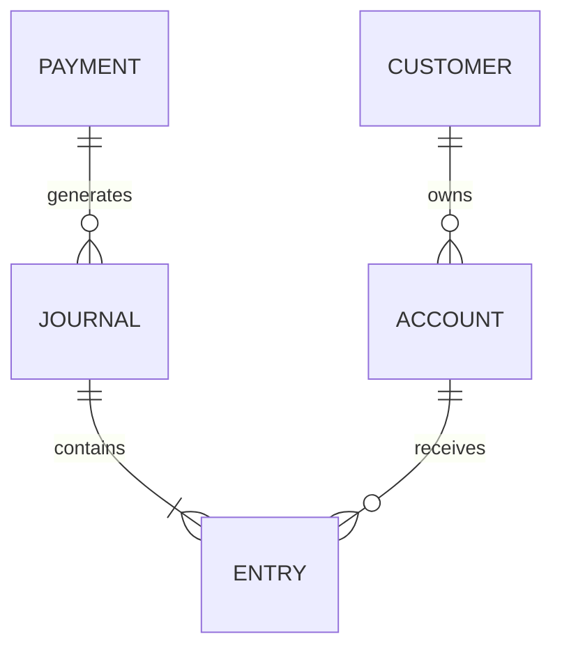

# 03 · ERD, chuẩn hóa và ranh giới nghiệp vụ

[Mục lục](../INDEX.md)

## Đi từ khái niệm đến vật lý

Mô hình khái niệm trả lời nghiệp vụ có những đối tượng gì. Mô hình logic xác định quan hệ, cardinality và khóa. Mô hình vật lý mới quyết định kiểu dữ liệu, index và partition.

Đừng gộp `Customer`, `UserLogin`, `Account` thành một bảng: một khách có thể có nhiều tài khoản, nhiều người được ủy quyền, và login có vòng đời riêng. Tương tự, người mua bảo hiểm, người được bảo hiểm và người thụ hưởng là các vai trò khác nhau của party.

ERD trên chỉ biểu diễn quan hệ. Nó chưa bảo đảm journal cân bằng, currency đúng hay khách được phép dùng account; phải ghi các invariant ngoài ERD.

## Chuẩn hóa với ví dụ

- 1NF: không nhét danh sách số tài khoản vào một ô CSV; dùng bảng con.
- 2NF: thuộc tính phải phụ thuộc toàn bộ khóa ghép. Trong `PolicyCoverage(PolicyId, CoverageCode)`, tên coverage thuộc catalog, không thuộc riêng hợp đồng.
- 3NF: không lưu tên chi nhánh lặp lại trên mọi customer chỉ để tránh join. Lưu `BranchId`, tên ở bảng branch.

Chuẩn hóa giảm update anomaly. Nếu chi nhánh đổi tên, chỉ sửa một nơi. Nhưng chứng từ đã phát hành có thể cần tên chi nhánh tại thời điểm phát hành: đó là **snapshot nghiệp vụ có chủ đích**, không phải bản sao thiếu kiểm soát.

## Denormalize khi đã có lý do

Balance projection, daily summary và search document là dạng dữ liệu dẫn xuất. Mỗi bản sao phải có chủ sở hữu, nguồn gốc, cơ chế cập nhật, giới hạn độ trễ và cách rebuild. Nếu lưu `CustomerName` trên payment, hãy nói rõ đó là snapshot lịch sử hay bản cache phải đồng bộ.

EAV hoặc JSON phù hợp với một số thuộc tính mở rộng ít truy vấn. Không đưa currency, amount, status và khóa đối soát vào JSON chỉ để khỏi migration; chúng cần kiểu dữ liệu, constraint và index rõ.

## Câu hỏi review

Quan hệ có bắt buộc không? Xóa parent xử lý thế nào? Một account có một hay nhiều currency? Mã nghiệp vụ có đổi không? Lịch sử phải giữ trạng thái trước hay chỉ trạng thái mới? Dữ liệu master dùng chung có hiệu lực theo ngày không?

**Bài tập:** thiết kế party-role cho bảo hiểm, có người mua là công ty và người được bảo hiểm là nhân viên. Đáp án cần bảng party, policy, policy-party-role và thời gian hiệu lực của vai trò; không chỉ thêm ba cột tên vào policy.
