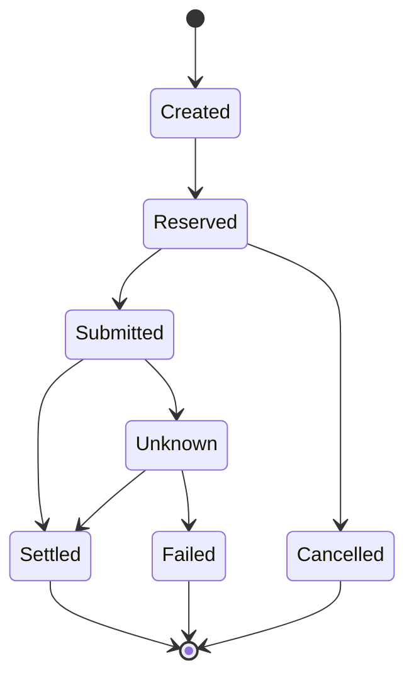

# 07 · Payment, giữ tiền và đối soát

[Mục lục](../INDEX.md)

## Payment không đồng nghĩa bút toán

Payment là yêu cầu chuyển tiền; journal là tác động vào sổ. Một payment có thể sinh hold, bút toán phí, settlement, reversal hoặc refund ở các thời điểm khác nhau. Tránh `PaymentId = JournalId` nếu quan hệ thực tế không phải một-một.

Đây là state machine minh họa. Mỗi transition cần chỉ rõ ai được gọi, expected state, version và side effect. Timeout khi gọi ngân hàng thường là **Unknown**, không đủ bằng chứng để kết luận Failed rồi hoàn tiền ngay.

## Hold có vòng đời riêng

Lưu `HoldId`, `AccountId`, amount, currency, reason, external reference, created/expiry/released time và state. Khi release hoặc capture, kiểm tra trạng thái bằng conditional update để không tác động hai lần. Scheduler hết hạn phải phối hợp callback: một transaction xác định bên thắng, bên còn lại đọc lại kết quả.

Giữ tiền, tạo payment và event outbox nên commit trong một ranh giới nguyên tử nếu cùng database. Không giữ database transaction mở suốt cuộc gọi mạng. Sau commit, worker gửi yêu cầu với idempotency/reference ổn định.

## Đối soát từ dữ liệu gốc

1. Lưu file/sự kiện gốc cùng hash, nguồn, thời điểm và mã batch; kiểm soát duplicate file.
2. Parse vào staging, ghi lỗi từng dòng, không bỏ qua âm thầm.
3. Chuẩn hóa timestamp, currency, dấu tiền và định danh trước khi matching.
4. Match theo khóa mạnh; nếu fallback amount/date, đưa trường hợp nhiều ứng viên sang review.
5. Phân loại matched, missing internal, missing bank, amount mismatch, duplicate, late arrival.
6. Chốt batch với tổng số dòng và tổng amount theo currency; giữ watermark/cut-off.

Không chỉ so tổng: hai sai lệch ngược dấu có thể triệt tiêu nhau. Phân biệt chênh lệch thời điểm với chênh lệch thật. Match một-nhiều cần nhóm có quy tắc và audit, không chọn ngẫu nhiên một dòng.

## Thiết kế bảng gợi ý

`Payment`, `PaymentAttempt`, `PaymentStatusHistory`, `Hold`, `ProviderEventInbox`, `ReconciliationBatch`, `StatementLine`, `ReconciliationMatch`, `ExceptionCase`. Attempt là một lần gọi; payment là nghĩa vụ gốc. Mất kết nối không phải lý do tạo payment mới.

**Bài tập:** callback settled đến hai lần, sau khi batch trước đã đóng. Đáp án: inbox unique chống lặp, transition hợp lệ, posting idempotent, và xử lý late arrival ở batch/adjustment được truy vết; không mở lại sổ cũ tự động.
