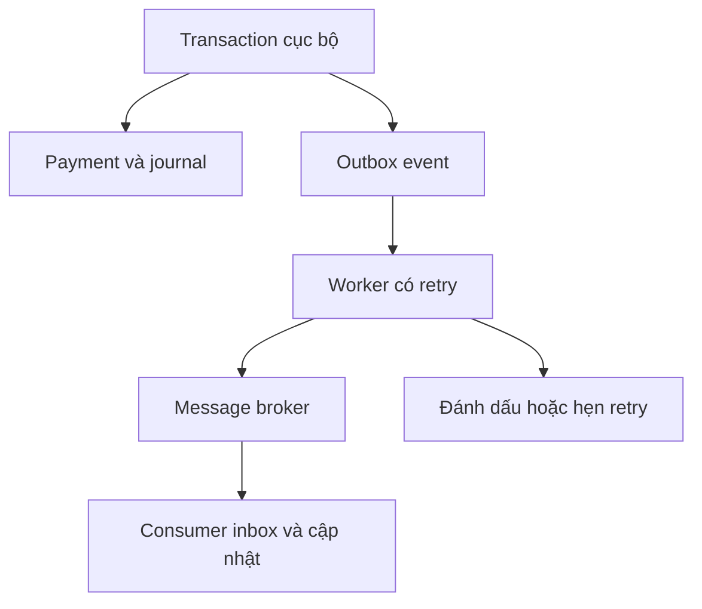

# 22 · Outbox, CDC và tích hợp hệ thống cũ

[Mục lục](../INDEX.md)

## Hai lần ghi độc lập có khoảng hở

Nếu commit payment rồi publish event, process chết ở giữa sẽ làm consumer không được báo. Nếu publish trước rồi database rollback, consumer có thể thấy sự kiện của giao dịch không tồn tại.

Outbox ghi business change và event trong cùng transaction cục bộ. Worker đọc event chưa gửi, publish rồi đánh dấu. Crash sau publish trước mark có thể gửi trùng; consumer cần inbox/deduplication và side effect nghiệp vụ cùng commit.

## Contract outbox

Lưu `EventId`, aggregate ID, aggregate version/sequence, event type, schema version, payload, created time, attempt count và publish/lease state. Worker nhiều instance cần claim nguyên tử và lease hết hạn có recovery. Chỉ xóa event sau retention và khả năng replay được quyết định.

Ordering thường cần theo aggregate, không phải toàn hệ thống. Consumer phải phát hiện sequence thiếu hoặc đến ngược; timestamp không đảm bảo thứ tự commit. Ghi oldest event age và dead-letter backlog, không chỉ số lần publish thành công.

## CDC khác domain event

CDC truyền thay đổi row; domain event mô tả ý nghĩa nghiệp vụ. Một `UPDATE Status=3` không giải thích được vì sao approval xảy ra hoặc version rule nào được dùng. CDC phù hợp đồng bộ read model/warehouse khi quản lý snapshot khởi tạo, source position, retention, schema change và replay.

Nếu consumer trễ hơn retention CDC, phải có quy trình resnapshot/reconcile. Giám sát capture/cleanup job theo platform; không mặc định mọi dịch vụ managed có cùng cách vận hành SQL Server Agent.

## Linked server, Informix và batch legacy

Ưu tiên đẩy filter và projection sang nguồn khi provider hỗ trợ, tránh kéo cả bảng qua mạng rồi lọc cục bộ. `OPENQUERY` có giới hạn và cú pháp passthrough riêng; không nối input người dùng chưa kiểm soát vào chuỗi query. So sánh kiểu số/ngày, encoding, collation, NULL và timezone ở cả hai phía.

Với EOD, staging theo batch + watermark có thể dễ kiểm soát hơn join live xuyên hệ thống. Lưu extract ID, thời điểm và tổng kiểm soát. Không giữ transaction tiền mở để đợi một linked server chậm, trừ khi đã chủ động thiết kế và kiểm chứng distributed transaction.

**Bài tập:** worker chết sau khi broker nhận event. Đáp án: có thể publish lại, consumer dedupe bằng EventId; outbox không tự làm mọi side effect bên ngoài thành exactly-once.

Nguồn: [Microsoft transactional outbox](https://learn.microsoft.com/en-us/azure/architecture/databases/guide/transactional-out-box-cosmos), [SQL Server CDC](https://learn.microsoft.com/en-us/sql/relational-databases/track-changes/about-change-data-capture-sql-server?view=sql-server-ver16). Bài outbox của Microsoft dùng Cosmos DB; triển khai quan hệ ở đây là diễn giải kiến trúc, không phải sao chép API Cosmos.
