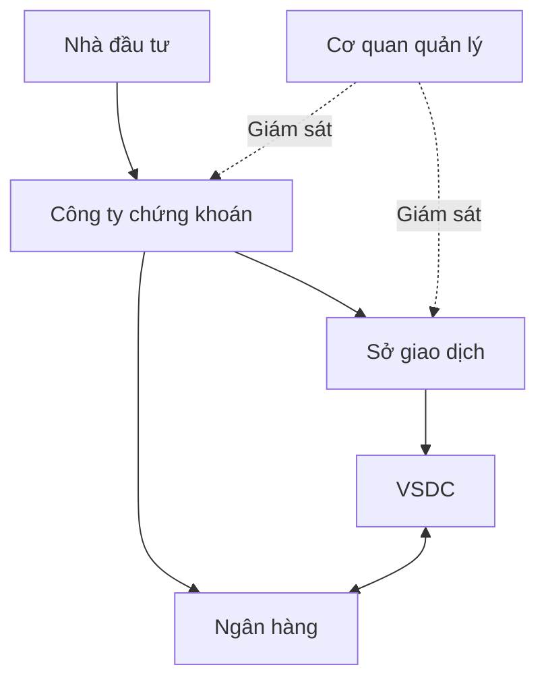

# Hệ sinh thái chứng khoán Việt Nam

> Bản đào tạo 1.0 • Rà soát: 07/11/2026 • Mức độ: Nền tảng → nâng cao  
> Phạm vi: kiến thức và thiết kế tham chiếu; ví dụ số liệu là giả lập. Quy tắc có ngày hiệu lực được quản lý riêng.

## Từ một nhu cầu kinh tế đến hệ thống giao dịch

Doanh nghiệp cần vốn; người có tiền cần công cụ đầu tư. Ở thị trường sơ cấp, tổ chức phát hành huy động vốn qua phát hành chứng khoán. Ở thị trường thứ cấp, nhà đầu tư trao đổi chứng khoán đã phát hành. Khi A mua cổ phiếu của B trên thị trường thứ cấp, tiền không tự động đi vào tài khoản của doanh nghiệp phát hành.

| Thành phần | Vai trò để hiểu luồng nghiệp vụ | Không nên đánh đồng |
|---|---|---|
| Bộ Tài chính, UBCKNN | Khung quản lý, cấp phép/giám sát theo thẩm quyền | Không phải OMS của nhà đầu tư |
| VNX, HOSE, HNX | Tổ chức thị trường, quy chế và vận hành giao dịch theo phân công | Không quản lý giao diện đặt lệnh của mọi CTCK |
| VSDC | Đăng ký, lưu ký, thực hiện quyền, bù trừ/thanh toán theo nghiệp vụ | Không phải bảng giá công ty chứng khoán |
| Công ty chứng khoán | Cung cấp dịch vụ theo giấy phép, nhận lệnh, kiểm soát và phục vụ khách hàng | Không mặc nhiên là đối tác mua/bán của mọi lệnh |
| Ngân hàng lưu ký/thanh toán | Dịch vụ tiền, lưu ký và thanh toán theo tư cách tham gia | Các vai trò ngân hàng không luôn thuộc cùng một tổ chức |
| Tổ chức phát hành, quỹ, nhà đầu tư | Phát hành, sở hữu, giao dịch, công bố thông tin | Mỗi nhóm có quyền và nghĩa vụ khác nhau |

Sơ đồ thể hiện quan hệ nghiệp vụ, không mô tả mọi đường truyền vật lý. Đường lệnh, đường dữ liệu giá và đường lưu ký/thanh toán là các luồng khác nhau, có thể hỏng độc lập.

## Ba sự kiện phải phân biệt

1. **Đặt lệnh:** nhà đầu tư bày tỏ ý định mua/bán.
2. **Khớp giao dịch:** xác lập giao dịch và nghĩa vụ liên quan.
3. **Hoàn tất thanh toán:** chuyển giao tiền/chứng khoán theo quy trình.

Không thể dùng một cột `Status=Success` cho cả ba. Người mua thấy “khớp 100” không đồng nghĩa 100 cổ phiếu đã được phép bán ngay; người bán thấy giá trị giao dịch không đồng nghĩa toàn bộ tiền có thể rút ngay.

## KRX và phạm vi hiểu đúng

UBCKNN công bố hệ thống KRX vận hành chính thức ngày 05/05/2025 [S01]. KRX là nền tảng hạ tầng thị trường; việc có nền tảng mới không tự động làm mọi sản phẩm như giao dịch trong ngày hoặc bán khống được phép triển khai. Mỗi khả năng cần quy chế, lịch triển khai, điều kiện thành viên và cấu hình được xác nhận.

## Tình huống

Bảng giá vẫn chạy nhưng khách hàng không đặt được lệnh. Team kết luận “Sở hoạt động bình thường nên lỗi khách hàng”. Kết luận này thiếu bằng chứng: đường market data có thể còn sống trong khi phiên order entry mất kết nối hoặc RMS từ chối. Cần kiểm tra từng tuyến.

**Bài tập:** phân loại “nộp tiền”, “khớp mua”, “cổ tức tiền”, “chuyển chứng khoán sang CTCK khác” theo bên chịu trách nhiệm và bằng chứng hoàn thành. **Gợi ý:** lần lượt là xác nhận ngân hàng + ledger, kết quả giao dịch, thông báo quyền + phân bổ, xác nhận chuyển khoản lưu ký; không dùng một loại thông báo cho cả bốn.

## Nguồn và phạm vi xác minh

Mã nguồn tham chiếu: S01, S02, S09, DESIGN. Xem [sổ nguồn](../13-reference/sources.md). `DESIGN` là phân tích, bài tập hoặc thiết kế do bộ wiki đề xuất; không phải mô tả hạ tầng nội bộ một công ty hay đặc tả giao tiếp của Sở.

[Danh mục chuyên mục](README.md) · [Trang đầu](../../README.md)
