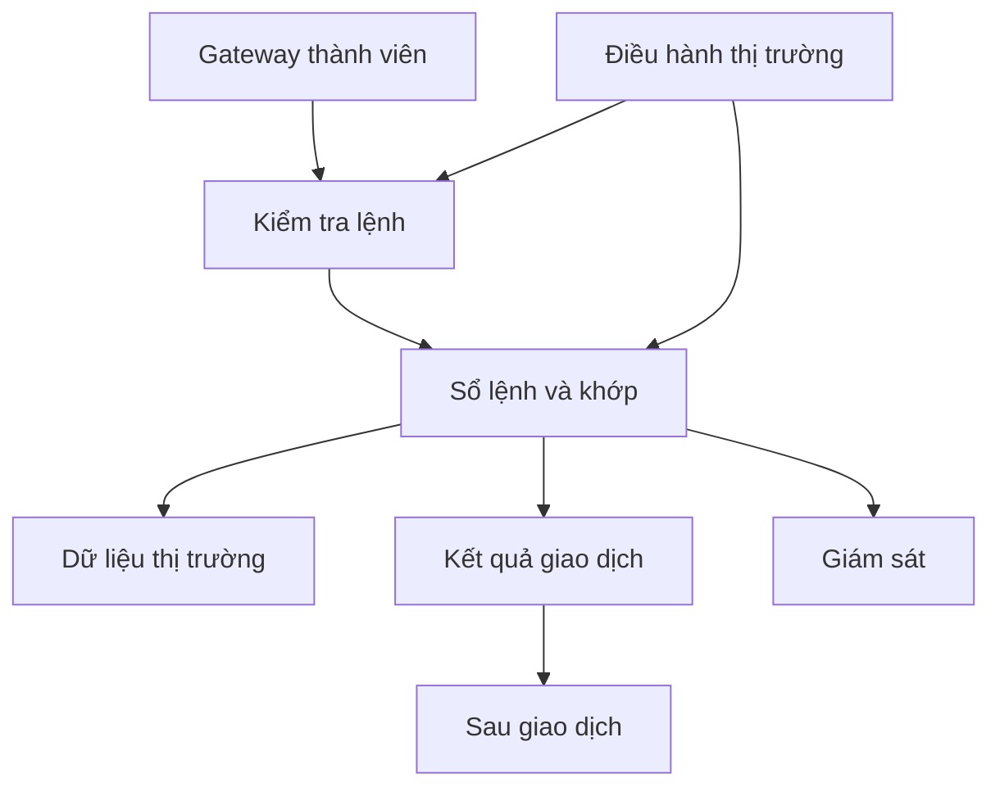

# Một ngày vận hành ở sở giao dịch

> Bản đào tạo 1.0 • Rà soát: 07/11/2026 • Mức độ: Nền tảng → nâng cao  
> Phạm vi: kiến thức và thiết kế tham chiếu; ví dụ số liệu là giả lập. Quy tắc có ngày hiệu lực được quản lý riêng.

## Kiến trúc chức năng tham chiếu

Sở tổ chức nhận lệnh từ thành viên, áp dụng quy tắc, tổ chức khớp, công bố dữ liệu và chuyển dữ liệu phục vụ sau giao dịch. Sơ đồ dưới đây là mô hình chức năng để học, không xác nhận topology triển khai KRX.

## Các giai đoạn nghiệp vụ

**Trước phiên:** xác nhận ngày giao dịch, danh mục mã, trạng thái hạn chế, giá tham chiếu/biên giá, quyền và cấu hình thành viên; chuẩn bị đường truyền, phiên kết nối và kênh giám sát. Không nạp dữ liệu danh mục của hôm qua rồi coi là hợp lệ hôm nay.

**Trong phiên:** điều hành chuyển trạng thái thị trường; nhận lệnh hợp lệ; xác định ưu tiên; phát kết quả; quản lý tạm dừng hoặc xử lý tình huống đặc biệt theo thẩm quyền. Đồng hồ của CTCK không được tự cho phép giao dịch khi trạng thái chính thức của thị trường đã thay đổi.

**Cuối phiên:** hoàn tất xử lý theo loại lệnh, phát kết quả phục vụ kiểm tra; đối chiếu số lượng và giá trị giao dịch. Công ty cần phân biệt kết thúc nhận lệnh, kết thúc từng phiên và kết thúc mọi hoạt động cuối ngày.

## Thị trường là state machine

Thiết kế các trạng thái `PREOPEN`, `AUCTION`, `CONTINUOUS`, `BREAK`, `HALTED`, `CLOSED` như abstraction nội bộ. Mapping sang trạng thái thực tế phải lấy từ tài liệu được cấp. Trạng thái theo mã có thể khác trạng thái chung: một mã hạn chế hoặc tạm ngừng không được xử lý như cả thị trường đang liên tục.

Thay đổi trạng thái cần event có sequence/version và thời điểm hiệu lực. UI có thể render chậm; server phải kiểm tra lại. Khi mất thông tin trạng thái, dùng chính sách fail-safe đã phê duyệt, không tự giả định OPEN.

## Góc nhìn điều hành

Khả năng xử lý lệnh, tính công bằng và khả năng phục hồi liên hệ chặt chẽ. Tăng throughput nhưng làm mất thứ tự có thể đổi kết quả khớp. Phục hồi từ backup nhưng không biết lệnh nào đã được chấp nhận có thể tạo giao dịch trùng. Vì vậy kiểm thử phải chứa thứ tự sự kiện, trạng thái giữa chừng và đối chiếu sau recovery.

**Bài tập:** nhận market status CLOSED trước một execution report đến chậm. Có bỏ execution không? **Đáp án:** không. Thời điểm nhận bản tin và thời điểm giao dịch khác nhau; báo cáo hợp lệ vẫn phải được xử lý idempotent.

## Nguồn và phạm vi xác minh

Mã nguồn tham chiếu: S01, S02, DESIGN. Xem [sổ nguồn](../13-reference/sources.md). `DESIGN` là phân tích, bài tập hoặc thiết kế do bộ wiki đề xuất; không phải mô tả hạ tầng nội bộ một công ty hay đặc tả giao tiếp của Sở.

[Danh mục chuyên mục](README.md) · [Trang đầu](../../README.md)
