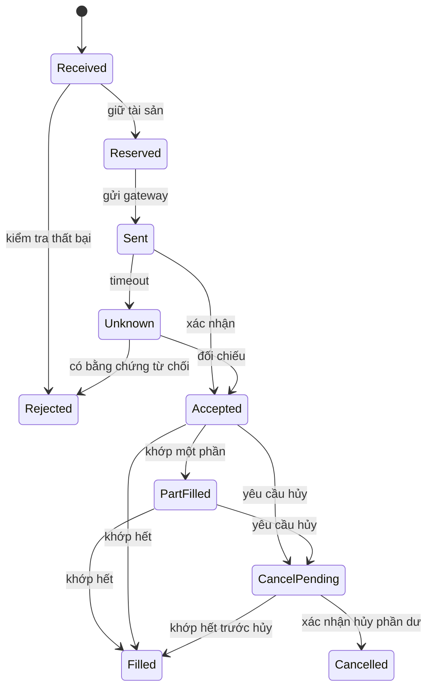

# Vòng đời lệnh và cuộc đua giữa khớp, hủy, sửa

> Bản đào tạo 1.0 • Rà soát: 07/11/2026 • Mức độ: Nền tảng → nâng cao  
> Phạm vi: kiến thức và thiết kế tham chiếu; ví dụ số liệu là giả lập. Quy tắc có ngày hiệu lực được quản lý riêng.

## Hai trục trạng thái

Đừng dùng một enum tuyến tính để che mọi tình huống. Có **trạng thái nghiệp vụ** của lệnh và **trạng thái truyền tin/độ chắc chắn**. Một lệnh có thể đã khớp một phần nhưng đang chờ hủy; sau timeout vẫn chưa biết sở nhận yêu cầu sửa hay chưa.

Sơ đồ giản lược; reject hủy phải đưa lệnh về trạng thái tính từ fill còn hiệu lực. Execution có thể đến trước acknowledgement tại hệ thống nội bộ do các đường truyền khác nhau; projector phải chịu được và không làm lùi cumulative quantity.

## Invariant định lượng

Với phạm vi lệnh chưa sửa và không có trade correction: `originalQty = filledQty + cancelledQty + workingQty`. Sau sửa phải dùng revision được chấp nhận; sau trade bust/correction phải lưu sự kiện điều chỉnh, không xóa fill để làm công thức đẹp.

Tách `clientRequestId`, `internalOrderId`, `exchangeOrderId`, `executionId`, `correlationId`. Mỗi ID có scope, thời hạn duy nhất và mục đích. Một UUID correlation không thay cho dedup key nếu mỗi lần retry lại tạo UUID mới.

## Kịch bản kiểm chứng

| Tình huống | Hành vi đúng |
|---|---|
| Gửi lệnh xong mất TCP | Giữ UNKNOWN; tra soát/recover, không tự gửi lệnh kinh tế mới |
| Nhận cùng execution hai lần | Ghi nhận một hiệu lực kinh tế, giữ dấu vết delivery |
| Cancel reject sau partial fill | Giữ fill; phần chưa khớp vẫn còn nếu không có sự kiện khác |
| Sửa tăng lượng | Reserve thêm trước khi gửi; giải tỏa nếu sửa bị reject theo policy |
| Sửa giảm lượng đang chờ | Chưa giải phóng mức giảm cho đến khi xác nhận đủ cơ sở |
| Đến cuối ngày còn UNKNOWN | Đưa vào hàng đợi xử lý ngoại lệ và đối soát; không ép thành EXPIRED |

## UI và ngôn ngữ sản phẩm

Hiển thị “Đã nhận yêu cầu”, “Đã gửi”, “Đã được Sở chấp nhận”, “Khớp một phần”, “Đang xác minh” theo bằng chứng. Nếu API trả 202, tài liệu phải giải thích đang nhận để xử lý, không có nghĩa lệnh chắc chắn nằm trên sổ. Từ “Thành công” cần nói rõ thành công của bước nào.

**Bài tập:** HTTP retry dùng cùng idempotency key nhưng giá khác. **Đáp án:** trả lỗi xung đột yêu cầu, không tái sử dụng kết quả cũ cho payload mới và không tạo lệnh thứ hai âm thầm.

## Nguồn và phạm vi xác minh

Mã nguồn tham chiếu: DESIGN. Xem [sổ nguồn](../13-reference/sources.md). `DESIGN` là phân tích, bài tập hoặc thiết kế do bộ wiki đề xuất; không phải mô tả hạ tầng nội bộ một công ty hay đặc tả giao tiếp của Sở.

[Danh mục chuyên mục](README.md) · [Trang đầu](../../README.md)
