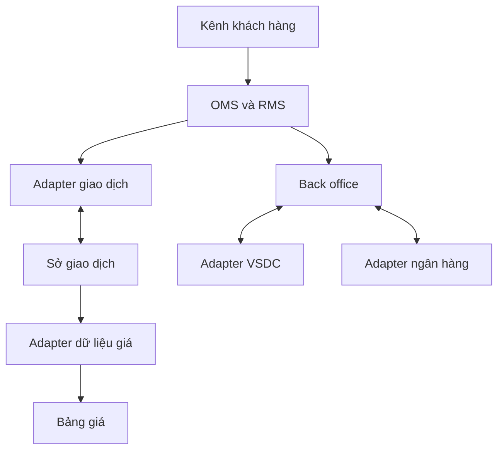

# CTCK kết nối Sở: tuyến lệnh, dữ liệu và sau giao dịch

> Bản đào tạo 1.0 • Rà soát: 07/11/2026 • Mức độ: Nền tảng → nâng cao  
> Phạm vi: kiến thức và thiết kế tham chiếu; ví dụ số liệu là giả lập. Quy tắc có ngày hiệu lực được quản lý riêng.

## Kết nối là một năng lực nghiệp vụ

Một đường mạng thông không có nghĩa được phép gửi lệnh. Cần tư cách thành viên phù hợp, kết nối được chấp thuận, tài liệu kỹ thuật có phiên bản, kiểm thử chức năng, kiểm thử khôi phục, người chịu trách nhiệm vận hành và cơ chế thay đổi. Quy chế kết nối CNTT VNX số 39 ngày 28/05/2026 được công bố tại S02; các chi tiết kỹ thuật phải lấy từ bộ tài liệu chính thức được cấp.

Không dùng websocket bảng giá công khai làm kênh nhận kết quả khớp riêng của khách. Mỗi adapter có contract, session, credential, quyền truy cập và cơ chế replay phù hợp.

## Bốn lớp cần đặc tả

| Lớp | Câu hỏi phải có câu trả lời |
|---|---|
| Mạng | Tuyến chính/dự phòng, phân vùng, giám sát, điều kiện chuyển tuyến? |
| Phiên | Định danh phiên, xác thực, sequence, logon/logout, heartbeat, recovery? |
| Nghiệp vụ | Loại message, order ID, reject, execution, sửa/hủy, trạng thái thị trường? |
| Điều hành | Ai mở phiên, liên lạc khi lỗi, phạm vi kiểm thử, cutoff, chứng cứ nghiệm thu? |

Không điền IP, port, heartbeat interval hoặc FIX tag bằng suy đoán. Thông tin đó khác theo dịch vụ/phiên bản và thuộc hồ sơ kết nối của thành viên.

## Trình tự triển khai tham chiếu

1. Chốt scope: thị trường, sản phẩm, kênh, lưu lượng và failover.
2. Nhận đặc tả, sample message và bộ test có version.
3. Mapping domain ↔ exchange, có danh sách thông tin bị mất khi chuyển đổi.
4. Kiểm thử conformance, lỗi parser, duplicate, reconnect, session rollover và sequence gap.
5. Diễn tập đối soát end-to-end qua cả back office.
6. Nghiệm thu, đăng ký/hoàn tất thủ tục theo quy định, cutover có tiêu chí dừng.

## Trạng thái giao tiếp với VSDC

VSDC công bố hướng dẫn hệ thống chuyển mạch điện nghiệp vụ số 70/QĐ-VSDC ngày 05/03/2026 [S08]. Đây là tuyến nghiệp vụ khác với order gateway của Sở. Cần mô hình gửi/nhận điện, xác nhận, timeout, đối soát và quản lý chứng thư theo tài liệu của tuyến đó; không lấy parser order entry tái sử dụng chỉ vì đều truyền bản tin.

**Bài tập:** có hai gateway active cùng dùng một session identity. **Đáp án:** phải kiểm tra contract phiên và cơ chế single-writer/fencing; không giả định load balancer tự chia request bảo toàn sequence.

## Nguồn và phạm vi xác minh

Mã nguồn tham chiếu: S02, S08, DESIGN. Xem [sổ nguồn](../13-reference/sources.md). `DESIGN` là phân tích, bài tập hoặc thiết kế do bộ wiki đề xuất; không phải mô tả hạ tầng nội bộ một công ty hay đặc tả giao tiếp của Sở.

[Danh mục chuyên mục](README.md) · [Trang đầu](../../README.md)
