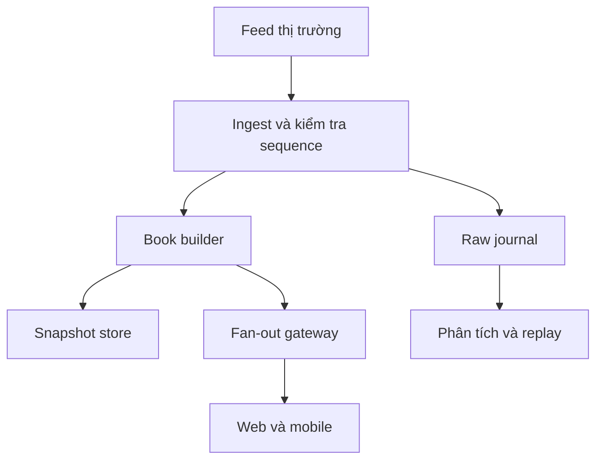

# Market data pipeline: snapshot, delta và phân phối

> Bản đào tạo 1.0 • Rà soát: 07/11/2026 • Mức độ: Nền tảng → nâng cao  
> Phạm vi: kiến thức và thiết kế tham chiếu; ví dụ số liệu là giả lập. Quy tắc có ngày hiệu lực được quản lý riêng.

## Từ feed đến màn hình

Tách raw event bất biến, normalized event và read model. Chuẩn hóa instrument ID, đơn vị giá, timestamp và trạng thái nhưng giữ khả năng truy ngược về raw để điều tra.

## Snapshot + delta đúng cách

Giả sử snapshot kết thúc ở sequence 100. Buffer delta trong khi tải snapshot, cài snapshot nguyên tử rồi áp dụng 101, 102…; bỏ delta ≤100. Nếu nhận 103 khi chờ 102, đánh dấu book không liên tục, dừng tuyên bố LIVE và khôi phục theo contract. Không “bỏ qua gói thiếu vì gói sau mới hơn” nếu delta là update tương đối.

Sequence có thể theo channel chứ không theo symbol. Snapshot có thể có marker riêng. Thuật toán cụ thể phải theo feed spec, không dùng một cách chung cho mọi nguồn.

## Phân phối cho nhiều người

Read fan-out khác write trading. Gộp update (conflation) có thể phù hợp một bảng giá hiển thị, nhưng không áp dụng tùy ý cho sổ audit, chiến lược hoặc phân tích cần mọi tick. Slow consumer cần bounded buffer; vượt mức thì disconnect/resnapshot, không giữ RAM vô hạn. Subscription cần quota và entitlement theo hợp đồng dữ liệu.

## Chất lượng dữ liệu

Theo dõi ingest lag, publish lag, sequence gaps, duplicate/conflict, snapshot duration, client lag, timestamp skew, số mã stale và các trường bất khả thi. `lastPrice=0` có thể là sentinel chứ không phải giá giao dịch. Control event như halt, session end, symbol mapping phải được xử lý như dữ liệu quan trọng.

## Dữ liệu cho quyết định tiền

OMS/RMS có thể dùng nguồn giá và logic định giá khác bảng điện. Mỗi quyết định cần biết price source, timestamp, quality flag và policy version. Không lấy giá vừa render ở browser gửi lên làm nguồn duy nhất quyết định sức mua.

**Bài tập:** hai feed dự phòng có cùng sequence nhưng khác epoch. **Đáp án:** khóa theo source/session/channel/epoch cần thiết; không dedup chỉ bằng sequence. Chuyển feed phải có điểm đồng bộ, kiểm tra equivalence và báo chất lượng.

## Nguồn và phạm vi xác minh

Mã nguồn tham chiếu: DESIGN. Xem [sổ nguồn](../13-reference/sources.md). `DESIGN` là phân tích, bài tập hoặc thiết kế do bộ wiki đề xuất; không phải mô tả hạ tầng nội bộ một công ty hay đặc tả giao tiếp của Sở.

[Danh mục chuyên mục](README.md) · [Trang đầu](../../README.md)
