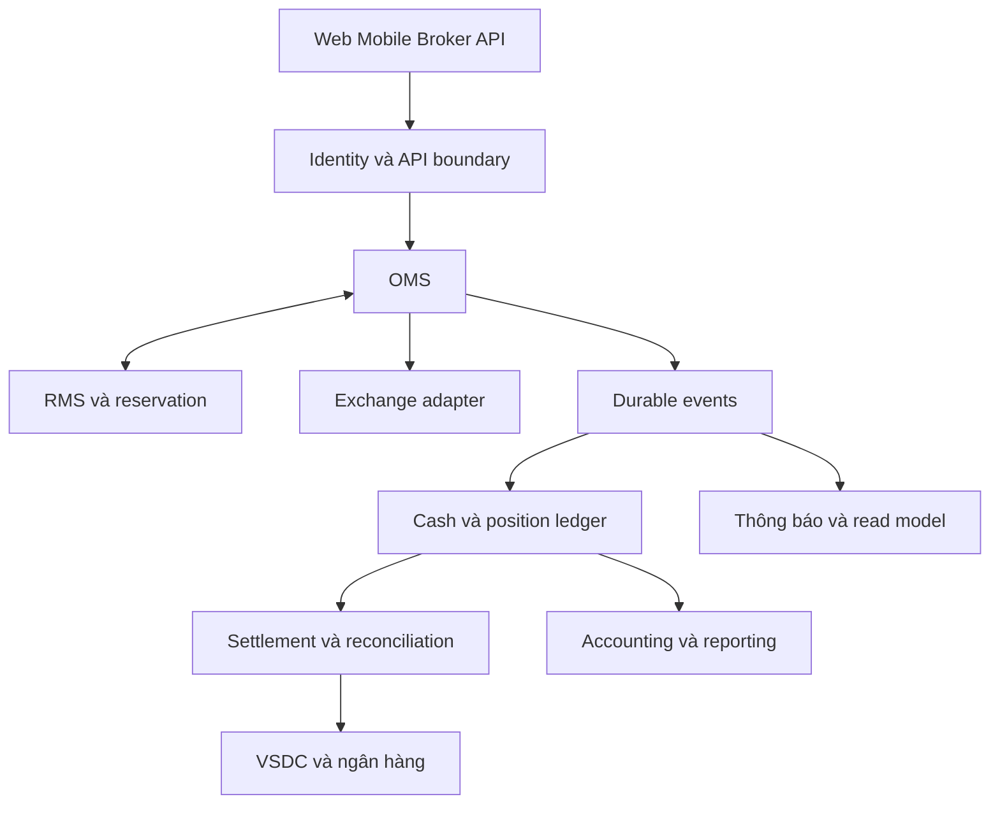

# Kiến trúc tham chiếu cho công ty chứng khoán

> Bản đào tạo 1.0 • Rà soát: 07/11/2026 • Mức độ: Nền tảng → nâng cao  
> Phạm vi: kiến thức và thiết kế tham chiếu; ví dụ số liệu là giả lập. Quy tắc có ngày hiệu lực được quản lý riêng.

## Bắt đầu từ ranh giới trách nhiệm

Tách domain theo quyền quyết định và invariant: customer/identity, trading, risk, cash, custody/positions, lending, market data, corporate actions, settlement, accounting và reporting. Không bắt đầu bằng câu hỏi cần bao nhiêu microservice. Một modular monolith với transaction rõ ràng có thể phù hợp hơn hàng chục dịch vụ chưa làm chủ consistency.

Đường mũi tên là quan hệ nghiệp vụ tham chiếu. OMS và reservation có thể cùng một deployment/transaction ở giai đoạn đầu. Nếu tách, phải nêu cơ chế bù trừ và trạng thái trung gian có thể xảy ra.

## Ai là nguồn sự thật?

| Dữ liệu | Quyền quyết định nội bộ | Bằng chứng bên ngoài |
|---|---|---|
| Ý định khách và vòng đời nội bộ | OMS journal | Request và xác thực |
| Chấp nhận/khớp tại Sở | Adapter ghi nhận, OMS phản ánh | Message/kết quả từ Sở |
| Tiền khả dụng | Ledger + reservation + policy | Ngân hàng và nghĩa vụ đã xác nhận |
| Vị thế lưu ký | Position ledger phản ánh | VSDC/custodian trong cùng phạm vi |
| Bảng giá | Market data read model | Feed được cấp quyền |

Không coi Redis là nguồn sự thật tài sản chỉ vì tốc độ cao. Không coi Sở là nguồn số dư tiền khả dụng khách hàng vì CTCK còn phí, hạn mức, phong tỏa và nghiệp vụ ngân hàng.

## Chọn synchronous và asynchronous

Lúc nhận lệnh cần kết quả quyền và giữ tài sản đủ nhất quán. Gửi notification, cập nhật dashboard và báo cáo thường có thể bất đồng bộ. Eventual consistency phải có UX trạng thái và cách phát hiện backlog. Bất đồng bộ không miễn trách nhiệm deadline.

## Độ trễ và tính đúng

Tách read-heavy market data khỏi write-critical trading. Caching reference data có version giúp giảm tải; caching available balance không có consistency model làm vượt sức mua. Đừng thêm Kafka vào mọi request chỉ để gọi là event-driven. Lựa chọn công nghệ phải đi từ SLA, tải, recovery và năng lực vận hành.

**Bài tập:** đặt ledger chung trong một bảng `Accounts` cập nhật từ mọi service. **Đáp án:** thiếu ownership và invariant; xác định API ghi sổ/transaction boundary, các consumer chỉ cập nhật projection riêng hoặc gửi command hợp lệ.

## Nguồn và phạm vi xác minh

Mã nguồn tham chiếu: DESIGN. Xem [sổ nguồn](../13-reference/sources.md). `DESIGN` là phân tích, bài tập hoặc thiết kế do bộ wiki đề xuất; không phải mô tả hạ tầng nội bộ một công ty hay đặc tả giao tiếp của Sở.

[Danh mục chuyên mục](README.md) · [Trang đầu](../../README.md)
